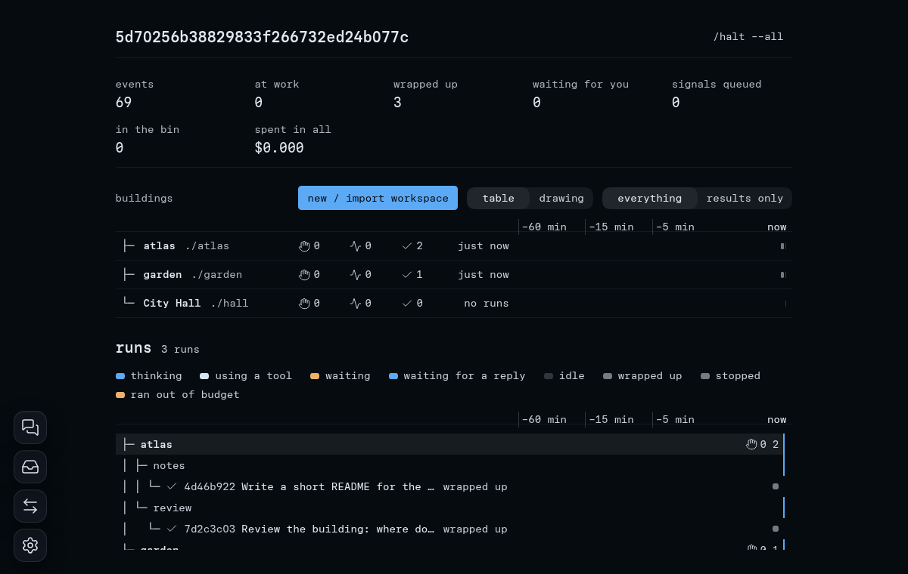

# *Sprawling* 🏙️

**Let agents live like citizens in the city of sprawling, where nothing is hidden: prompts are plain files you own, and every context is a line in a hash-chained, offline-verifiable Ledger you can replay.**

<p><a href="README.md">English</a> · <a href="README.zh-CN.md">简体中文</a></p>

<p>
  <a href="https://crates.io/crates/sprawling"></a>
  <a href="https://www.npmjs.com/package/sprawling"></a>
  <a href="https://docs.rs/sprawling"></a> ·
  <a href="https://zread.ai/2youg1/sprawling-agents"></a>
  <a href="https://deepwiki.com/2youg1/sprawling-agents"></a>
  <a href="LICENSE"></a>
  <a href="https://github.com/2youg1/sprawling-agents/releases"></a>
</p>

<a name="what-it-does"></a>

## What you can do

Give a team a place to work. In Sprawling, a workspace is a city where projects live in buildings, agents work in rooms, and handoffs stay in files you can open. Drop in to see what changed while you were away.

- **Set the rules in your own files.** Own the prompts, write boundaries and review rules. Choose where an agent can work before the run starts.
- **Follow the work all the way back.** Look from a Git commit to the run, its prompt, tool results and evidence. Verify and replay the Ledger offline without calling the model again.
- **Keep the workspace on your machine.** Start with the Rust host and its embedded WebUI. Use the terminal when you want it, or run just Mei when a whole city is too much.

This source tree is at <!-- xtask:begin workspace_version -->0.18.3<!-- xtask:end -->.

<p align="center">
  <a href="docs/images/city-overview.webp"></a>
  <br><sub>The city overview follows work across two demo projects.</sub>
</p>

## Quick start

1. Install Sprawling with Bun.

   ```sh
   bun install --global sprawling@latest
   ```

2. Open a new terminal and start your first city. If `sprawling` is not found, run `bun pm bin --global` and add the reported directory to `PATH`.

   ```sh
   sprawling up ./cities/first
   ```

3. In the browser, connect a model provider, select a model for `main`, and give the Mayor a first task.

The terminal starts as the quiet host. Press Esc to enter the CLI, then type `/web` to reopen the page and return to the quiet host, or `/quit` to stop the city. For standalone installers and prebuilt archives, see the [installation and release verification guide](docs/start/getting-started.md#1-install).

<a name="projects"></a>

## Project map

| Project | What you can do |
|---|---|
| [Sprawling](Sprawling/README.md) | Run a team of agents, then trace a Git commit back to the run and its review. |
| [RefRain](RefRain/README.md) | Write Markdown, read PDFs, and take over an agent session or inspect Git changes in the same browser workspace. |
| [Calyx](Calyx/README.md) | Stay in the terminal: read long output with the input still in reach. |
| [Mei](Mei/README.md) | Use one persistent Python tool, bring your own tooling, or run Mei as an ACP worker. |
| [Kasanagi](Kasanagi/README.md) | Planned cross-machine collaboration, not yet shipped in this repository. |
| [Tools](Tools/README.md) | Check, replay, measure and package the projects without shipping the development tools. |

## Documentation

[Documentation index](docs/README.md) · [Documentation for models](LLM.md)

### Use and extend Sprawling

- [Getting started](docs/start/getting-started.md) · [简体中文](docs/start/getting-started.zh-CN.md)
- [Operating a city](docs/operate/operating.md)
- [Integrating tools and agents](docs/integrate/integrations.md) · [CLI and wire reference](docs/wire.md)

### Contribute

- [Architecture](docs/ARCHITECTURE.md) · [Contribution guide](docs/CONTRIBUTING.md) · [Repository agent instructions](AGENTS.md)

<a name="sources-and-credits"></a>

## Releases and project information

- [Release history](docs/CHANGELOG.md)
- <a name="code-signing-policy"></a> [Release verification and code signing](docs/start/getting-started.md#select-and-verify-a-version)
- [Security reporting](docs/SECURITY.md) · [Credits and licences](docs/third-party.md)
- <a name="why-i-built-this"></a> [Project background](Sprawling/background.md)
