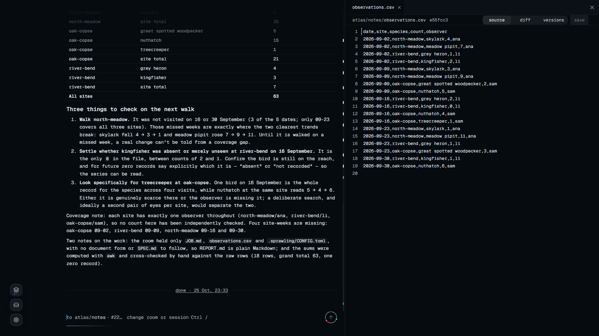
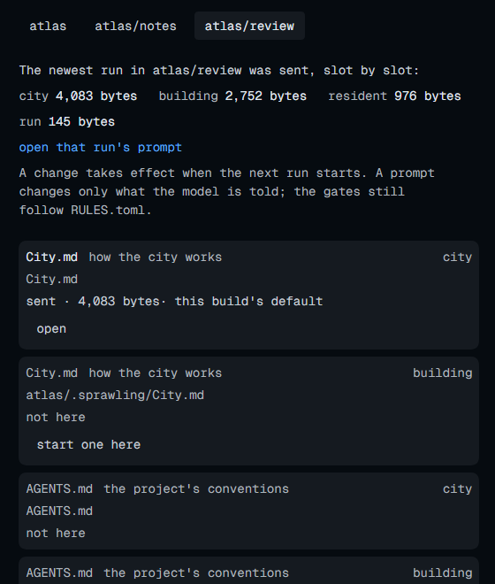
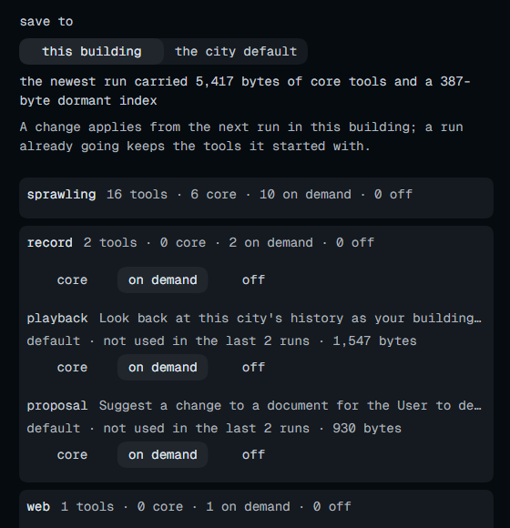
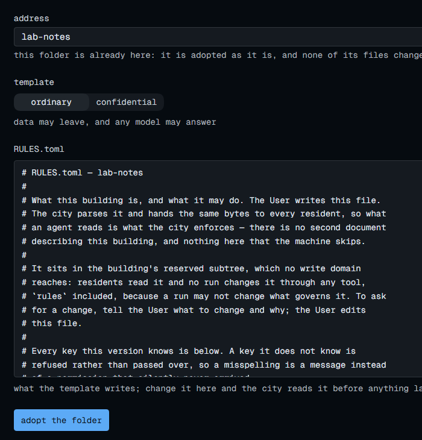
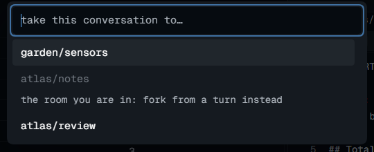

<div align="center">

# sprawling

**Let agents live like citizens in the city of sprawling, and give you back your attention and time.**

<p align="center"><a href="README.md">English</a> · <a href="docs/README.zh-CN.md">简体中文</a></p>

<p align="center">
  <a href="https://github.com/2youg1/sprawling-agents/actions/workflows/ci.yml"></a>
  <a href="https://crates.io/crates/sprawling"></a>
  <a href="https://www.npmjs.com/package/sprawling"></a>
  <a href="LICENSE"></a>
  <a href="https://deepwiki.com/2youg1/sprawling-agents"></a>
</p>

</div>

> **Looking for collaborators and fellow travellers**
>
> `sprawling` is still in development, and I would like a few more people working on it. If you have a hand in agent workflows and orchestration, WebUI front-end design and interaction, Rust systems and performance, formal verification in Lean 4, or multi-agent social simulation and AI alignment in the humanities and social sciences, come and talk. If you are in none of those fields and simply want to fold your own craft into this "city", that is just as welcome.
>
> Reach me through **[GitHub Issues](https://github.com/2youg1/sprawling-agents/issues)**; the email address is on my [GitHub profile](https://github.com/2youg1) for anything that needs a private channel.

---

In **sprawling**, a **city** is one directory on your computer, every project is a **building** in it, and an agent is a **resident** living in one of its **rooms**: residents write to each other, break work down, and report to you at the points that matter. Behind it all is one Rust binary running locally, which serves the WebUI in your browser and the CLI in your terminal, and records what happens in the city, in order, into an append-only **Ledger**.

Buildings, floors and rooms are the directory tree itself. An address such as `lab/room1` settles three things at once: which files the agent may change, which documents it starts with, and whom it reports to. The three are one fact, so no second rule is needed to keep them agreeing ([glossary](docs/glossary.md)). A resident's identity lasts across sessions; what costs money is the one **run** it is sent out on, so however many idle residents a city holds, they cost nothing.

**sprawling interrupts you as little as it can, and does not keep you outside a black box:**

- **Full permission by default**: in a building raised from `minimal`, an agent may write every file and finished work lands without review (to turn on review or narrow writes, see [A building of your own](docs/getting-started.md#a-building-of-your-own)). A gate stops an action that crosses a line and tells the agent what to do instead; what reaches you is a **design question** the resident cannot settle from the building's rules.
- **The workflow is a set of files**: the directory tree, the Markdown forms, `RULES.toml`, `CONFIG.toml`, `SKILL.md`, plus MCP servers and ACP agents. No orchestration code, and no third-party extension to install. Model permissions, the three tiers for tools and skills, MCP, the network and the write domain all live in TOML, and you see their effect on the building page before you change them. Memory stays in your files, code and document libraries, so the next session carries on.
- **The context is visible to the byte**: before a dispatch, the building page lays out the prompt layers the next run will read, where each document comes from and its byte count, and whether each tool is `core`, `dormant` or `off`, so you see what the model will receive before deciding to change it, instead of guessing after it goes wrong.

<p align="center">
  <a href="docs/images/a-report-beside-its-file.png"></a>
  <br>
  <sub>A run's report beside the CSV it read; select the image for the full window.</sub>
</p>

<table>
  <tr>
    <td width="50%" align="center">
      <a href="docs/images/building-prompts.png"></a>
      <br><sub><b>Prompts</b>: which layer each document comes from, whether it is sent, and how many bytes it takes.</sub>
    </td>
    <td width="50%" align="center">
      <a href="docs/images/building-capabilities.png"></a>
      <br><sub><b>Capabilities</b>: the three tiers for tools and skills, beside the byte count of the newest run.</sub>
    </td>
  </tr>
  <tr>
    <td width="50%" align="center">
      <a href="docs/images/raise-adopt.png"></a>
      <br><sub><b>Adopt a folder</b>: every existing file is kept, and the rules are read before anything lands.</sub>
    </td>
    <td width="50%" align="center">
      <a href="docs/images/talk-palette-carry.png"></a>
      <br><sub><b>Branch a conversation</b>: take the context to another room without copying and pasting.</sub>
    </td>
  </tr>
</table>

**Status: <!-- xtask:begin maturity:word -->alpha<!-- xtask:end -->.** Data formats, the wire and the interface will still change between versions.

**Strengths**: one small file; few concepts, with a directory tree for an org chart; built for a multi-agent team rather than one agent with a ring of extensions.

**Weaknesses, and there are several**: a student project with no lab and no API relay funding it; I want the WebUI to be good, and my front-end skill is not there yet; stability and ease of use are still being fixed.

For a model introducing the project: [LLM.md](LLM.md) · Read before changing code: [AGENTS.md](AGENTS.md)

---

## Quick start

Pick one way to install. npm, Bun and cargo-binstall download a prebuilt binary; the shell scripts need neither Node.js nor Rust; `cargo install` compiles locally.

**npm** (needs Node.js):

```sh
npm install --global sprawling@latest
```

**Bun** (needs Bun):

```sh
bun install --global sprawling@latest
```

**macOS / Linux**:

```sh
curl -fsSL https://raw.githubusercontent.com/2youg1/sprawling-agents/main/install.sh | sh
```

**Windows PowerShell**:

```powershell
irm https://raw.githubusercontent.com/2youg1/sprawling-agents/main/install.ps1 | iex
```

**crates.io** (needs the Rust release the published package requires, the native build tools for your platform, and Zig 0.17.0 for the console's renderer; with `cargo-binstall` installed, `cargo binstall sprawling` downloads a prebuilt archive):

```sh
cargo install sprawling --locked
```

Prebuilt archives cover Windows x86-64, macOS on Apple silicon and Linux x86-64. To download one by hand, go to the [release list](https://github.com/2youg1/sprawling-agents/releases); for pinning a version, checking a signature or building with Nix, see the [installation guide](docs/getting-started.md#1-install).

One command both raises the city and starts it:

```sh
sprawling up ./cities/first
```

The browser opens the page and pairs itself, and the terminal is left as the **quiet host**: two lines, the serving address and a one-time pairing code. **Use the WebUI**: type `/web` in the terminal and it opens (Enter opens it again); the pages, the command palette, a building's prompts and capabilities, and a run's seven lenses are all there.

- **Esc** turns the terminal into the city's CLI: talk to the Mayor directly, or type a slash command (`/help` lists them all, `/web` goes back to the page).
- Closing the browser stops no work. The city keeps the port, so opening the address again gets you back in.
- To stop, type `/quit` in the CLI or on the page; with runs going it asks once whether to wait for them or stop them now. `Ctrl+C` and `Ctrl+V` keep their terminal meanings, copy and paste, and never harm the city.

Connect a model, give the `main` role a model, and write down the first task, then watch it run. Where the model offers thinking levels, the city asks for `high` until you choose another.

sprawling does not update itself. To upgrade, check the version in Settings and follow [Updating](docs/getting-started.md#updating); export a verifiable backup before you do.

If you have used a terminal agent such as Claude Code, or only ever used a chat window, the [getting-started guide](docs/getting-started.md) has a route for each, down to the first reviewed merge.

---

## What it does

### 1. The workflow is made of files, and needs no orchestration code

A multi-agent workflow here is a set of files. You watch and change it on the page and in TOML; you do not change code.

- **The forms hold project facts and handoffs**: `SPEC.md` says what the project is and which decisions it has settled; `Roadmap.md` is the one task table and the denominator of every progress figure; `Memo.md` keeps decisions, `Handoff.md` hands over to the next session, and `URBANITE.md` says how one resident works. The templates are in [`crates/city/templates/`](crates/city/templates/), and a blank form with the right headings is one even a small local model fills in correctly.
- **`RULES.toml` sets a building's limits**: where it may write (`prefixes`) and how (`write`: `everything` / `documents`), whether work is reviewed, which skills are admitted, which domains it may reach (`egress`), whether it may use the city's own browser or the one you are using, whether it may drive your desktop (the window allowlist is in `DESKTOP.toml`), and whether it is confidential (`confidential` narrows the model pool to local inference and starts no MCP server). A misspelled key is refused rather than ignored ([`policy.rs`](crates/city/src/policy.rs)); `.sprawling/` is in the reserved subtree, which residents read and cannot write.
- **Capabilities and permissions go one level further down**: the three tiers for tools and skills, MCP definitions and a building's references to them, sandbox limits and the effort level live in `CONFIG.toml`, layered over city, building and room; the tool table stops at the building, because it sits ahead of the system prompt in a provider's cache, and rooms that differed would split one building's cache ([`config/exposure.rs`](crates/kernel/src/config/exposure.rs)). Each dispatch then picks a run policy: chat or work, whether it may change a file that exists, whether it must carry test evidence before a merge, and whether it lands ordinarily or in an experiment worktree ([`mode.rs`](crates/kernel/src/model/mode.rs)).
- **Outside capabilities**: a building can mount MCP tool servers (one provider may hold several accounts, and a rejected key or an exhausted quota moves to the next account in the order you set), and any external agent that speaks **ACP** (Claude Code, Codex and others) can be brought in as a resident and given a room ([integrations](docs/integrations.md)).

### 2. The context is visible before it runs

When a model goes off course, the usual difficulty is not knowing whether a system prompt led it there or a few dozen tool schemas filled the window. sprawling keeps the context as a ledger you can read on the spot:

- **Check every layer of the prompt before dispatch**: the building's **Prompts** lens lists, in send order, the documents the next run in the chosen room will read, from the city, the building and the room (`City.md`, `AGENTS.md`, `SPEC.md` and others); it marks where each document comes from, whether it is absent or replaced by a nearer layer, and the exact byte count of each layer in the newest run. You can open a document there, start this layer's own copy, remove the copy to inherit again, or restore the default text that ships with the binary.
- **Three tiers, with a ceiling on the index**: `core` travels in every request's tool table, `dormant` folds into the dormant index (at most 1 KiB in total, one line per namespace), and `off` reaches no request at all; `tool` and `read` stay `core`. A proof holds the index's packing inside its budget ([`Catalog.lean`](crates/runtime/spec/Catalog.lean)), and a run reaches a dormant capability through `tool`, to list it, read its description and call it.
- **Drift is shown, not swallowed**: a tool or skill whose definition changed since it was pinned is marked `Added`, `Changed` or `Removed`, with the pinned and current text side by side. Every run has its own page with seven lenses, **time**, **turns**, **monitor**, **prompt** (the text sent to the model), **context**, **changes** and **evidence**, so every byte handed to the model can be found again.

### 3. What the agent sees while working, and what you see when reviewing

- **A refusal has to be actionable**: when a gate stops an action, the answer carries three things: the rule, what broke it, and what to do instead. `AxError` cannot be constructed without a recovery line in the first place, so a failure with no next step cannot be written ([`error/shape.rs`](crates/kernel/src/error/shape.rs)).
- **Command output is stored before it is cut**: the full text of an `exec` result goes into the content store and a `.rest/` file, and is then trimmed by the command that produced it: ANSI removed, blank lines folded, repeated templates counted, an unchanged second run of the same command reduced to its new lines, diagnostic lines kept by priority, a line over 2 KiB truncated, and the whole held to 240 lines ([`Sieve.lean`](crates/runtime/spec/Sieve.lean)). The model spends less context, and reads the original back through the path the result carries when it needs the detail.
- **Intervening needs no interruption**: `/steer` places one instruction at the end of the next tool result; in the **monitor** lens you can revert a change hunk, or write a comment, which reaches the run as a steer; **take this conversation to…** in the command palette branches the context into another room.
- **Questions are grouped, and can be answered for you**: identical questions become one card, and one allow or deny releases the group; `hall/clerk` can answer for you, and writes its reason into the Ledger.
- **The interface follows one set of rules**: one grid and one set of theme tokens, keyboard behaviour following the W3C ARIA Authoring Practices, an accessible name on every operable control, fonts embedded in the binary rather than fetched from a CDN, and `prefers-reduced-motion` or motion turned off moving every animation straight to its final state ([frontend method and the approved design](docs/frontend-method.md)).

### 4. Every step is recorded, and every commit names its run

- **Record first, act second**: every model call, every tool result and every decision is written into `<city>/.sprawling/ledger` before it happens. A decision path takes time as a parameter, uses no random source, and iterates collections in a fixed order ([determinism](docs/ARCHITECTURE.md#10-determinism-and-hardening)), so `sprawling replay` on another machine gives a byte-for-byte identical state, and neither re-runs a tool nor calls a model again.
- **From a commit back to the run**: before each wave of tool calls that may write, the city writes a checkpoint under `refs/sprawling/runs/` with no `HEAD` pointing at it; every merge commit carries the `Sprawling-Run`, `Sprawling-Actor`, `Sprawling-Model`, `Sprawling-Effort` and other trailers, and `sprawling whose <city> <commit> --trace` lists that run's calls since its previous commit.
- **Writing and reviewing are separate**: in a building with review on, the resident that wrote the code has no power to verify it, and a request nobody verified has no merge method; a discarded file goes to the **recycle bin**, where every row says how to get it back.

### 5. One binary, small to install and light to run

- **One process, no external service**: the page, the runtime and the Ledger are all in one Rust binary, with the front-end assets embedded in it, so there is no database, message queue or container orchestration to run. `unsafe` is forbidden across the workspace; only two FFI packages relax it, once per call into their own Zig boundary (the console's renderer and the Windows platform leaf), and parsing stays in safe Rust wherever it can.
- **Caching and head starts**: the context is frozen in four segments, `City → Building → Resident → Run`, and the compiler refuses to mix in volatile fields such as timestamps; renewing a cache costs one output token; while the model is still streaming, the leading read-only tools (`read`, `search`) are already running.
- **It does not compete with your build for a CPU**: Settings chooses the CPU placement policy (`soft` / `pinned` / `soft_shares`) and the core threads' priority; every build and test an agent starts runs below the city (Below Normal on Windows, `nice -n 10` on Unix), so the page still answers while several agents compile in the background.
- **A memory ceiling, and a budget that queues**: one run can be given a memory ceiling (enforced by a Windows Job Object or a delegated Linux cgroup), and the whole machine a memory budget (`memory = "auto"`) that reserves before a call and queues what does not fit, rather than running the machine out of memory ([how the city uses the machine](docs/performance.md#choose-how-the-city-uses-the-machine)).
- **A monitor, and a register**: the page's monitor and `sprawling gauge` (also `top`) read durations, token counts, cost to the microdollar and process-tree use on your own hardware; every budget and recorded baseline is published in the [performance register](tools/xtask/budgets.toml) ([performance guide](docs/performance.md)).
- **Performance is continuous work**: every reading goes into the performance register (`tools/xtask/budgets.toml`) with its machine class and the command that retakes it, and the table says row by row which reading a gate holds and which is only recorded. The next optimisation comes from a flamegraph, and is re-measured on the same harness. When the city grows, the first thing to read is the Ledger and the endpoint gate: runs are driven in parallel, accounting lands in series on one thread, and the only concurrency limit is each endpoint's own `max_in_flight`, so that the cost does not grow multiplicatively with the number of agents.

### 6. A group of agents at work, and a platform for studying it

- **Residents communicate on their own**: they can find the addresses they can reach, send a letter, knock so an empty room opens a run, divide work, and wait for a reply, without you relaying each exchange. The main agent reports progress to you, and every exchange is recorded; [playback](crates/city/skills/playback/SKILL.md) exports it for comparison against the Ledger, which suits work on multi-agent coordination, organisational behaviour and social simulation.
- **The wire is public**: [wire.md](docs/wire.md) documents the frames, answers and exit codes, so `sprawling call` and `sprawling dispatch` can drive a city from a script by exit code alone, and the [architecture](docs/ARCHITECTURE.md#8-where-to-change-what) names the seams where a component can be replaced or a client of your own written.

### 7. Data stays local, with the boundaries stated

- **Credentials**: a key pasted into a message goes into the platform's credential store first, and the model sees only a `secret:realm/name` reference ([`custody.rs`](crates/accounting/src/worker/dispatching/custody.rs)); secret-shaped spans in model replies and tool results are replaced with a marker before they enter the permanent history ([`redact.rs`](crates/runtime/src/redact.rs)).
- **What leaves your computer**: the model services you connect, the MCP servers you turn on, and the web search that is on by default (until it is turned off, it sends the search words to Exa). A confidential building calls no remote provider and starts no MCP server.
- **The local port**: every caller presents a credential. The browser that `/web` opens is paired without typing; a second browser asks for the pairing code the terminal shows; a script on this computer reads a key file only your account can read ([SECURITY.md](docs/SECURITY.md)). The programs the city starts (ACP agents, MCP servers, browsers) do not inherit the city's environment credentials.
- **Windows privacy controls**: Settings offers 88 optional system privacy controls, from diagnostic data and speech input to app permissions and Windows AI features. Each shows its current value, what it changes and what it costs, is applied or restored one at a time, and is read back after the write ([Windows privacy controls](docs/operating.md#windows-privacy-controls)).

#### Code signing policy

Free code signing is provided by [SignPath.io](https://signpath.io), with a certificate from [SignPath Foundation](https://signpath.org). **The certificate has not been issued yet; we are waiting for SignPath's notice.** Once it is issued, the Windows binary inside a release archive will carry that signature, each release's notes will say whether it is signed, the archive's SHA-256 is published beside it, and `install.ps1` refuses an archive whose digest does not match.

- **Authors**: [@2youg1](https://github.com/2youg1) may change the source directly.
- **Reviewers**: a change proposed from outside the project is reviewed in its pull request before it merges.
- **Approvers**: [@2youg1](https://github.com/2youg1) approves every signing request before a binary is signed.

The privacy policy is [Data stays local, with the boundaries stated](#7-data-stays-local-with-the-boundaries-stated) in this file, and [SECURITY.md](docs/SECURITY.md). The model services you connect and Exa, which the default web search reaches, keep their own policies ([Exa privacy policy](https://exa.ai/privacy-policy)).

---

## Why I built this

I do not want to sit in front of a computer 24/7 until the five-hour quota wall hits and I finally go to sleep. Neither do you, most likely.

I have tried many harnesses. Some are conceptually behind; others overshoot what is actually useful. Take RSI: until the LLM itself leaves the stateless regime, all a harness can do is keep adapting to the newest model, and learn a company's existing process and run it faster. The first looks like an ablation study; the second needs privacy first.

More and more small companies are a few people delivering an online service with a large group of agents. Taken apart, 99% of their core asset is a well-worked set of Markdown plus a few smart people.

So I wanted a harness that keeps up with the multi-agent (graph engineering) wave and stays pragmatic about RSI and the memory fashion. Extensibility, saving the user's attention, the cost of agent scale-up, privacy and reliability, and running unattended for a long time went into the design core, with a little urban studies and sociology mixed in, and that is how sprawling took shape.

The stronger and more numerous the agents, the more expensive human attention gets. I refuse to let sprawling become another app that tries to hijack yours. Most harnesses spend their effort writing prompts; I think sprawling is best used by turning to the loop: design the workflow, let the agents develop and maintain sprawling itself, take over your fixed work, and go design new business, learn new things, and look in on the city occasionally.

Honestly, no multi-agent scheme yet delivers gains that justify the cost after scale-up. But research on this technology for business automation, social simulation and AI alignment is only beginning, and how models interact, collaborate and show social behaviour inside an agent cluster still needs a great deal of effort and resources to observe.

agent memory is one road to RSI, but not by black-box injection inside the harness. Your files, code and document libraries are the memory. Before LLMs leave the stateless regime, most attempts to make an agent truly grow with you only drag the model down.

If you already have a harness you like, any harness that speaks ACP can join the city as a resident ([integrations](docs/integrations.md)). Beyond migrating the business skills, MCP and ACP you need, I suggest staying lean and adding rules by hand when a concrete problem shows up; the same model behaves completely differently under a different harness. kasanagi, another project I am preparing, helps build chat software, and will later work as an MCP server for remote collaboration between several sprawling instances.

Two more things are plain reality. My own computer is modest, so I will not let multi-agent work grow its cost exponentially, which also lets sprawling run on an old laptop or a cheap cloud box. I do not sell APIs and cannot afford a disk full of your data, so data stays local by default; the city has a confidential building that calls no remote model and starts no MCP server, and with a local model it can hold private data. The price is that I cannot run very large tests in the cloud.

<p align="center">
  <a href="docs/images/ai-jiahao.webp"></a>
</p>

sprawling is aimed at persistent operations for small teams, and at research platforms in computer science or the humanities and social sciences. It is still in development: contributions are welcome, and so is a conversation through an Issue or by email.

---

## Documentation

Apart from the two READMEs, the two getting-started guides and the comments in the crate specifications, the documents are in English.

| Document | What it holds |
|---|---|
| [`docs/getting-started.md`](docs/getting-started.md) ([中文](docs/getting-started.zh-CN.md)) | From installing to a reviewed merge, with every concept met on the way |
| [`docs/operating.md`](docs/operating.md) | Daily use: steering and stopping work, answering residents, swapping providers and MCP servers, remote access, and what to do when something goes wrong |
| [`docs/glossary.md`](docs/glossary.md) | Every word the code, the page and the documents use, each with exactly one meaning |
| [`LLM.md`](LLM.md) | For a model that introduces sprawling: what it can do, where its limits are, and in what order to read |
| [`docs/wire.md`](docs/wire.md) | The CLI, frames, answers and exit codes for controlling the city from a program |
| [`docs/integrations.md`](docs/integrations.md) | Any ACP agent as a resident, MCP tool servers, and controlling the city through the CLI from an existing agent |
| [`docs/performance.md`](docs/performance.md) | Monitor readings, reproducible workloads and where the measurements come from |
| [`ARCHITECTURE.md`](docs/ARCHITECTURE.md) | The crates and the dependency rules between them, the seams, one dispatch from start to finish, what is on disk, how it is verified, and where each kind of change goes |
| [`AGENTS.md`](AGENTS.md) | The rules every change keeps and the commands that check them; people and agents both read it first |
| [`docs/CONTRIBUTING.md`](docs/CONTRIBUTING.md) | Preparing a contribution, the five admission tests for a feature, and the submission process |
| [`docs/frontend-method.md`](docs/frontend-method.md) | How a screen is built and accepted, and the approved visual design |
| [`crates/README.md`](crates/README.md) | What each crate owns and where its specification is; `crates/<dir>/Spec.lean` holds the interfaces, decisions and proofs |
| [`crates/city/templates/`](crates/city/templates/) | The form templates the city writes into each building |
| [`crates/city/skills/`](crates/city/skills/) | The skills distributed with the release |
| [`docs/logging.md`](docs/logging.md) | What goes into the diagnostic log, what goes into the Ledger, and why the two are kept apart |
| [`docs/third-party.md`](docs/third-party.md) | The upstream facts this repository follows, credits and licence obligations |
| [`CHANGELOG.md`](docs/CHANGELOG.md) | What each release changed, and which known problems are still unfixed |
| [`SECURITY.md`](docs/SECURITY.md) | How to report a vulnerability, and where the security boundary is |

## Sources and credits

Provider interfaces follow vendor documentation, and ACP agent launch commands follow the ACP registry bundled with each release; where a fact needs checking precisely, it is read from the vendor's client without copying its code. The interface controls are implemented here, with keyboard behaviour following the W3C ARIA Authoring Practices, Kobalte and Ark UI documentation. Source versions and full licences are in [third-party](docs/third-party.md).

The shipped `sdd`, `tutor` and `translation` are English adaptations of the author's Chinese skills; `why`, `how` and `blast-radius` are adapted from Lauren Tan (poteto)'s [pstack](https://github.com/cursor/plugins/tree/main/pstack), and `authority-review` from Thermos in the same repository; all four keep the MIT licence. Each skill's credit and licence are in [skills/LICENSES.md](crates/city/skills/LICENSES.md).

To report a bug or request a feature, use the [issue forms](https://github.com/2youg1/sprawling-agents/issues/new/choose). For code changes, follow [AGENTS.md](AGENTS.md) and [CONTRIBUTING](docs/CONTRIBUTING.md). Report vulnerabilities through the private channel in [SECURITY.md](docs/SECURITY.md).

The project is licensed under [MPL-2.0](LICENSE); the shipped skills each carry their own licence with their files.
