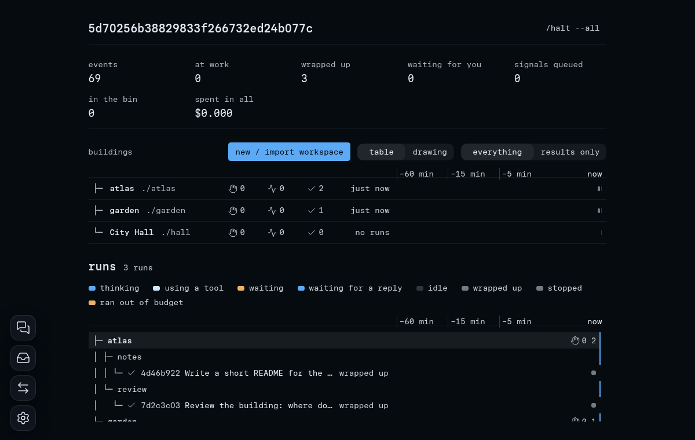

# *Sprawling* 🏙️

**让 Agent 像市民一样生活在 sprawling 这座没有黑箱的“城市”里，提示词是你拥有的纯文本文件，每段上下文都是哈希链 Ledger 中可离线验证、可重放的一行。**

<p><a href="README.md">English</a> · <a href="README.zh-CN.md">简体中文</a></p>

<p>
  <a href="https://crates.io/crates/sprawling"></a>
  <a href="https://www.npmjs.com/package/sprawling"></a>
  <a href="https://docs.rs/sprawling"></a> ·
  <a href="https://zread.ai/2youg1/sprawling-agents"></a>
  <a href="https://deepwiki.com/2youg1/sprawling-agents"></a>
  <a href="LICENSE"></a>
  <a href="https://github.com/2youg1/sprawling-agents/releases"></a>
</p>

<a name="核心特色与设计亮点"></a>

## 能用它做什么

给一群 Agent 一个能长期工作的地方。工作区是一座城市，项目各有自己的楼，Agent 在房间里分工，交接写进你能随时打开的文件。你不用守着聊天窗口，也能知道工作走到了哪儿。

- **规则写在自己的文件里。** 提示词、写入范围和审查规则都能打开看；运行开始前，就能划定 Agent 在哪儿做事。
- **从结果追到过程。** 从 Git 提交追到发起它的运行，再看提示、工具输出和验收证据。Ledger 可以离线校验和重放，不会重跑工具或再次调用模型。
- **工作区放在自己的机器上。** Rust 主机内嵌 WebUI，也有原生终端；不需要整座城时，可以只运行 Mei。

当前源码版本为 <!-- xtask:begin workspace_version -->0.18.3<!-- xtask:end -->。

<p align="center">
  <a href="docs/images/city-overview.webp"></a>
  <br><sub>演示城市里有两栋项目楼。总览展示各楼的运行情况。</sub>
</p>

## 快速开始

1. 用 Bun 安装 Sprawling。

   ```sh
   bun install --global sprawling@latest
   ```

2. 打开新终端，启动第一座城市。如果找不到 `sprawling`，运行 `bun pm bin --global`，并把返回的目录加入 `PATH`。

   ```sh
   sprawling up ./cities/first
   ```

3. 在浏览器里连接一个模型 provider，为 `main` 选择模型，再把第一项任务交给 Mayor。

终端启动后显示安静宿主。先按 Esc 进入 CLI，再输入 `/web` 重新打开页面并返回安静宿主，或输入 `/quit` 停止城市。独立安装脚本、预编译包和版本验证方式见[安装指南](docs/start/getting-started.zh-CN.md#1-安装)。

## 项目地图

| 项目 | 你可以做什么 |
|---|---|
| [Sprawling](Sprawling/README.zh-CN.md) | 带一队 Agent 分工和交接，再从 Git 提交追到运行和验收。 |
| [RefRain](RefRain/README.zh-CN.md) | 在浏览器里写 Markdown、读 PDF，也能接续 Agent 会话并查看 Git 变更。 |
| [Calyx](Calyx/README.zh-CN.md) | 留在终端里读长输出，输入框一直在手边。 |
| [Mei](Mei/README.zh-CN.md) | 只用一个持久的 Python 工具；自己掌控工具，也能接成 ACP 子代理。 |
| [Kasanagi](Kasanagi/README.zh-CN.md) | 规划中的跨机器协作组件，尚未迁入。 |
| [Tools](Tools/README.zh-CN.md) | 检查、重放、测量和打包；这些工具不随产品发布。 |

## 文档

[文档索引](docs/README.md) · [模型阅读入口](LLM.md)

### 使用与扩展 Sprawling

- [上手指南](docs/start/getting-started.zh-CN.md) · [English](docs/start/getting-started.md)
- [日常运行](docs/operate/operating.md)
- [工具与 Agent 集成](docs/integrate/integrations.md) · [CLI 与 Wire 参考](docs/wire.md)

### 参与贡献

- [架构](docs/ARCHITECTURE.md) · [贡献指南](docs/CONTRIBUTING.md) · [Agent 工作规范](AGENTS.md)

<a name="来源与致谢"></a>

## 发布与项目信息

- [发布记录](docs/CHANGELOG.md)
- <a name="代码签名政策"></a> [校验版本与代码签名](docs/start/getting-started.zh-CN.md#选一个版本核对来源)
- [报告安全问题](docs/SECURITY.md) · [来源和许可](docs/third-party.md)
- <a name="为什么做它"></a> [项目缘起](Sprawling/background.zh-CN.md)
