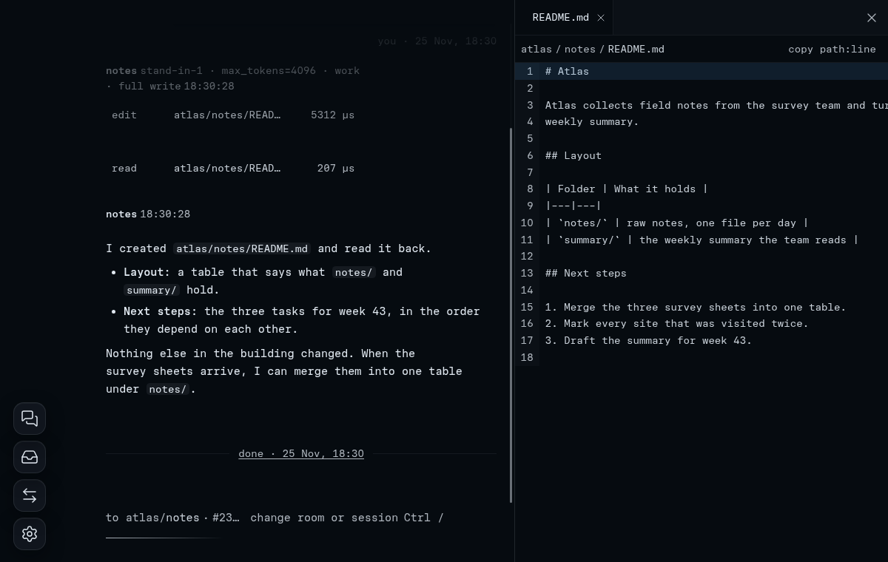

<!-- This Source Code Form is subject to the terms of the Mozilla Public
License, v. 2.0. If a copy of the MPL was not distributed with this
file, You can obtain one at https://mozilla.org/MPL/2.0/.
Copyright (c) 2026 2youg1 and the sprawling contributors
-->

# RefRain

[简体中文](README.zh-CN.md)

**Read the source, write the draft, and keep the agent's work in view.** RefRain is both a document workspace and the browser face of the Sprawling agent harness. You can read and write without asking a model, then pick up a session when you want help.

- **A workspace for your own writing.** In File mode, add an existing local folder with **Add workspace**. This registers the folder in place: Markdown autosave writes to that folder, so start with a copy if you want to leave the originals untouched. You can undo edits and return to the same reading position. Read PDFs with zoom and page previews; when you do involve an agent, attach a selection or an original-pixel region from the page.
- **A workspace for running agents.** Follow a conversation and its tool calls, resume a selected session or branch it explicitly. Review Git commits and project diffs, restore a file from a recorded commit, and trace city commits back to the runs that made them.
- **One workspace, two jobs.** Open the file a run produced next to the conversation that produced it. The Rust host owns file versions, accepted writes and persistent city state; the browser remembers layout, reading positions and drafts.

<p align="center">
  <a href="../docs/images/refrain-workspace.webp"></a>
</p>

In the demo workspace, the conversation shows a run and its tool calls beside the file the run wrote.

## Quick start
Start an installed Sprawling host with `sprawling up ./cities/first`. If the page is closed, press Esc in the host terminal to enter the CLI, then type `/web`. To try the reader and editor, skip model setup, use **Add workspace** with an absolute folder path on the host, then open a Markdown or PDF file. **New / import workspace** in the city is a separate action that copies a host folder into a building. To try agent work, connect a model, open a Session and inspect its conversation and project changes.

## Run against a city

From the repository root, build the bundle and start the Rust host. A browser opened directly at the server address pairs with the code from the local console.

```sh
just build-web
cargo run --locked -p sprawling -- up ./cities/first
```

The host owns dispatch, authentication and persistent city state. RefRain uses the [city wire](../docs/wire.md) through its generated decoders. For pairing and first use, see [Getting started](../docs/start/getting-started.md).

## Toolchain

| Tool | Role |
|---|---|
| Bun 1.4.5 | Installs the locked dependency tree, builds and checks TypeScript, and runs the browser-condition tests. |
| Solid 2 | Renders the workspace, document editor, conversation, administration, and gallery. |
| Vite 8 | The official Solid plugin compiles one embedded client. Format engines and their assets load from that same origin. |
| Native CSS | The theme publishes semantic roles and stylesheets, an explicit cascade, a responsive workspace grid and utility selectors used by existing looks. |
| Oxlint | Type-aware diagnostics cover the TypeScript modules, Solid views and alternate looks. |
| Effect 4 | Schemas decode frames before their values reach a view. |

## Commands

```bash
bun install --frozen-lockfile
bun run lint       # type-aware Oxlint with zero warnings allowed
bun run typecheck  # TypeScript and Solid JSX
bun run test [file...]          # the logic next to what it judges
bun run build      # production client for Rust to embed
```

`cargo xtask gates` runs the gates that judge this directory from
outside: `npm` (lockfile and licences), `wording` (every word from
`lang.json`), `color` (colour only in the theme), `budget` (bundle
size), `render` (what was drawn), `wiring` (every wire verb reachable).
See the [frontend method](../docs/maintain/frontend-method.md) for how a screen is built and accepted.

## Where code goes

| Path | What lives there |
|---|---|
| `src/core/` | plain `.ts`: the socket, the belief folds, the keymap, the phrase table's reader, preferences. The domain exposes framework-independent readables. Solid views subscribe through `core/solid_store.ts`. |
| `src/ui.ts` | the one gate out of `core/` to components: `setUi` at startup, `ui()` everywhere else. |
| `src/views/` | route components, document views and workspace controls. |
| `src/views/parts/` | the controls this repository draws itself — the only home for a button, a field, a badge, a dialog, a tooltip. Adding one means `RefRain/Spec.lean` §9 first. |
| `src/views/gallery/` | the fixtures `#/gallery` serves and `cargo xtask render` measures. |
| `src/theme.css` | the theme's entry: it imports the parts in `src/theme/` in cascade order, and the theme is the only place allowed a colour literal. |
| `src/lang.json` | every word a reader is given, both languages. |
| `src/wire/` | generated by `cargo xtask wire-ts` in dependency-ordered chunks; committed, never edited. |
| `scripts/` | Browser-driven repository checks: `walk.ts` photographs the running client, and `HotKeyE2E.ts` checks its main flows using keyboard events alone. |

The interfaces, the keyboard table and the accessibility contracts are
in [`RefRain/Spec.lean`](../RefRain/Spec.lean).

## Documentation

- [Keyboard and accessibility contracts](Spec.lean) · [Frontend method](../docs/maintain/frontend-method.md) · [UI design](../docs/maintain/ui-design.md)
- [First city and pairing](../docs/start/getting-started.md) · [Operating the host](../docs/operate/operating.md)
