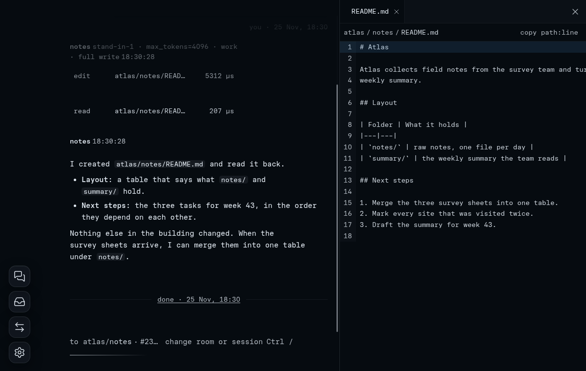

# RefRain

[English](README.md)

RefRain 是 Sprawling 的浏览器工作区。文件和对话共用同一个工作区，可在阅读、编辑和查看 Session 之间切换。浏览器保存版式、阅读位置、外观和草稿。项目登记、文件身份、版本、写入确认和城市运行由 Rust 主机负责。原生终端控制台由 [Calyx](../Calyx/README.zh-CN.md) 提供。

<p align="center">
  <a href="../docs/images/refrain-workspace.webp"></a>
</p>

同一工作区打开了演示项目的对话和文件，可对照工具调用、答复与文件内容。

## 运行本地客户端

在仓库根目录构建生产客户端，再启动提供页面和离线资源的主机。

```sh
just build-web
cargo run --locked -p sprawling -- up ./cities/first
```

浏览器直接打开服务地址时，可用主机控制台显示的配对码完成配对。首次配置和模型连接见[上手指南](../docs/start/getting-started.zh-CN.md)。

## 开发与检查

在 `RefRain/` 下使用项目固定的 Bun 版本。

```sh
bun install --frozen-lockfile
bun run lint
bun run typecheck
bun run test
bun run build
```

Solid 细分各工作区视图，Vite 将资源打包供 Rust 嵌入。视图在 [`src/views/`](src/views/)，浏览器状态在 [`src/core/`](src/core/)，界面文案来自 [`src/lang.json`](src/lang.json)。[`src/wire/`](src/wire/) 的解码器由 `cargo xtask wire-ts` 生成，供浏览器读取[城市 wire](../docs/wire.md)。

[RefRain SPEC](Spec.lean) 定义界面、键盘和无障碍合同。[前端方法](../docs/maintain/frontend-method.md) 记录设计与验收流程，[英文 README](README.md) 列出更完整的源码地图。
