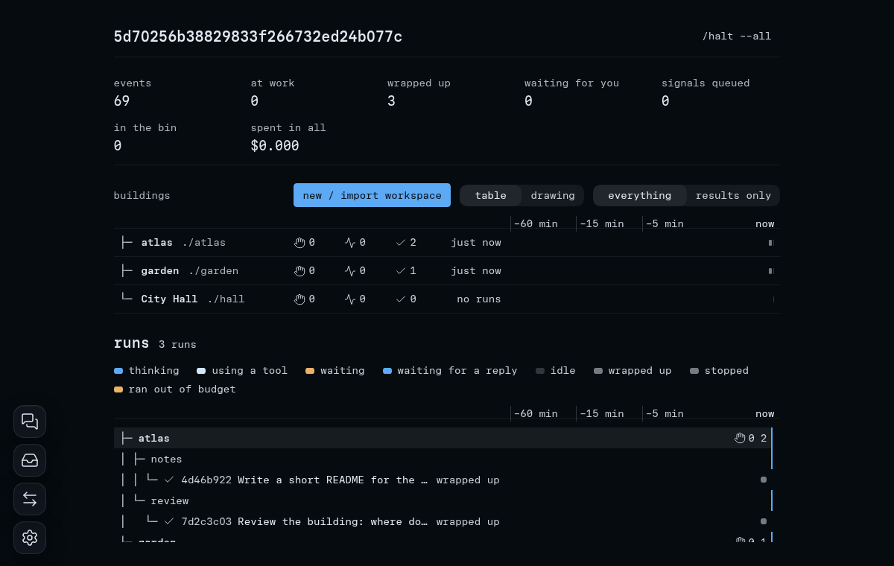

# *Sprawling* 🏙️

**让 Agent 像市民一样生活在 sprawling 这座没有黑箱的“城市”里，提示词是你拥有的纯文本文件，每段上下文都是哈希链 Ledger 中可离线验证、可重放的一行。**

<p><a href="../README.md">English</a> · <a href="README.zh-CN.md">简体中文</a></p>

<p>
  <a href="https://crates.io/crates/sprawling"></a>
  <a href="https://www.npmjs.com/package/sprawling"></a>
  <a href="https://docs.rs/sprawling"></a> ·
  <a href="https://zread.ai/2youg1/sprawling-agents"></a>
  <a href="https://deepwiki.com/2youg1/sprawling-agents"></a>
  <a href="../LICENSE"></a>
  <a href="https://github.com/2youg1/sprawling-agents/releases"></a>
</p>

<a name="核心特色与设计亮点"></a>

Sprawling 在用户的电脑上运行一组协作 Agent。工作目录是一座城市，项目是楼，房间里的居民可以拆分任务、协作并向你汇报。一个 Rust 可执行文件提供浏览器工作区和终端控制台，并把运行记录写入可离线验证的 Ledger。

先读[第一座城市](start/getting-started.zh-CN.md)，了解模型、写入范围和审查规则。当前源码版本为 <!-- xtask:begin workspace_version -->0.18.2<!-- xtask:end -->。

<p align="center">
  <a href="images/city-overview.webp"></a>
  <br><sub>演示城市里有两栋项目楼。总览展示各楼的运行情况。</sub>
</p>

## 快速开始

已有 Bun 时，从下面这两条命令开始。

```sh
bun install --global sprawling@latest
sprawling up ./cities/first
```

打开页面后，连接一个模型 provider，为 `main` 选择模型，再把第一项任务交给 Mayor。终端启动后显示安静宿主。先按 Esc 进入 CLI，再输入 `/web` 重新打开页面并返回安静宿主，或输入 `/quit` 停止城市。[安装指南](start/getting-started.zh-CN.md#1-安装)列出独立安装脚本、预编译包和版本验证方式。

## 项目地图

| 项目 | 职责 |
|---|---|
| [Sprawling](../Sprawling/README.md) | 城市主机、命令行及产品 Rust crates。 |
| [RefRain](../RefRain/README.zh-CN.md) | 文件与对话共用的浏览器工作区。 |
| [Calyx](../Calyx/README.zh-CN.md) | Sprawling 和 Mei 共用的原生终端控制台。 |
| [Mei](../Mei/README.zh-CN.md) | 独立 Agent harness，支持终端和 ACP 使用方式。 |
| [Kasanagi](../Kasanagi/README.md) | 规划中的远程协作组件。 |
| [Tools](../Tools/README.md) | 开发检查、模拟、测试与打包工具。 |

## 文档

- [上手指南](start/getting-started.zh-CN.md)与[文档索引](README.md)。
- [日常运行](operate/operating.md)、[工具与 Agent 集成](integrate/integrations.md)和[结构](ARCHITECTURE.md)。
- [贡献指南](CONTRIBUTING.md)、[Agent 工作规范](../AGENTS.md)与[模型阅读入口](../LLM.md)。
- <a name="来源与致谢"></a> [发布记录](CHANGELOG.md)、[报告安全问题](SECURITY.md)与[来源和许可](third-party.md)。
- <a name="为什么做它"></a> [项目缘起](reference/background.zh-CN.md)
- <a name="代码签名政策"></a> [校验版本与代码签名](start/getting-started.zh-CN.md#选一个版本核对来源)
