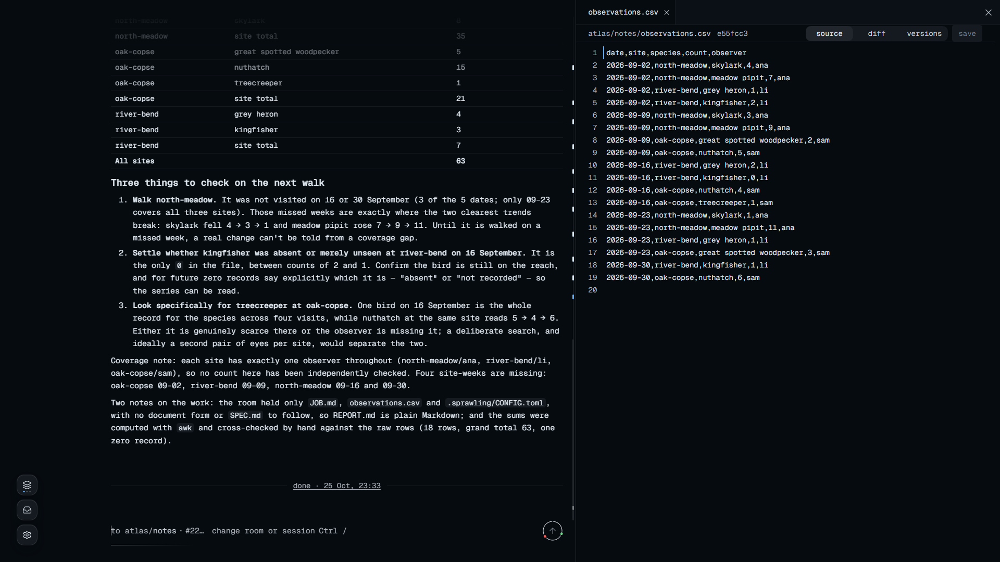
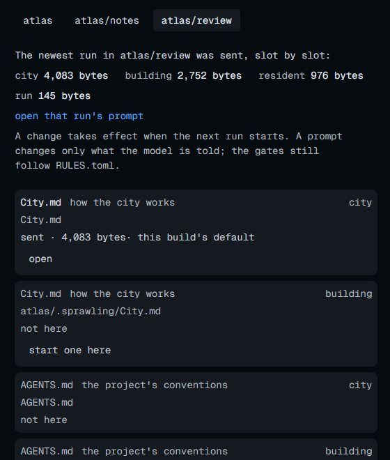
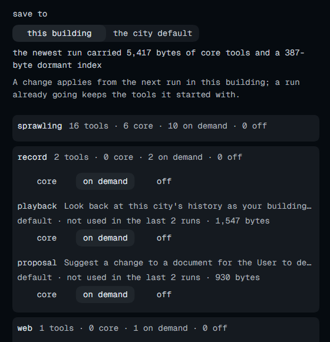
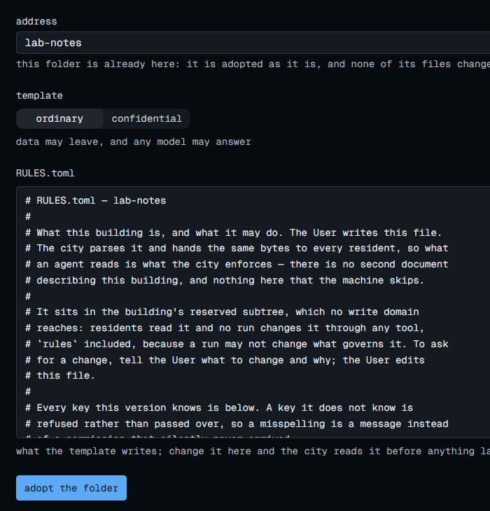
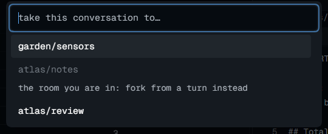

# *Sprawling* 🏙️

**让 Agent 像市民一样生活在 sprawling 这座没有黑箱的“城市”里，提示词是你拥有的纯文本文件，每段上下文都是哈希链 Ledger 中可离线验证、可重放的一行。**

<p><a href="../README.md">English</a> · <a href="README.zh-CN.md">简体中文</a></p>

<p>
  <a href="https://docs.rs/sprawling"></a>
  <a href="https://crates.io/crates/sprawling"></a>
  <a href="https://www.npmjs.com/package/sprawling"></a>
  <a href="../LICENSE"></a>
  <a href="https://deepwiki.com/2youg1/sprawling-agents"></a>
  <a href="https://github.com/2youg1/sprawling-agents/actions/workflows/ci.yml"></a>
</p>

> **寻找协作者与同路人**：`sprawling` 仍在开发中，欢迎新的协作者，也欢迎各种反馈。<br>
> 通过 **[GitHub Issues](https://github.com/2youg1/sprawling-agents/issues)** 找我。需要私下交流时，邮箱在我的 [GitHub 主页](https://github.com/2youg1) 上。

---

在 **sprawling** 里，一座**城市（city）**就是你电脑上的一个目录，每个项目是城里的一栋**楼（building）**，Agent 作为常驻居民（resident）住在楼的**房间（room）**里。它们互相发信、拆解任务、各司其职，做到关键节点再向你汇报。**Rust 单二进制进程**：它直接向浏览器提供 WebUI、在终端提供原生 CLI，并将城市里发生过的每一件事记入只追加的 **Ledger（账本）**。

这座城市不只是个比喻：**楼、楼层和房间就是磁盘上的目录树本身**。因此，像 `lab/room1` 这样一个地址，同时定死了三件事——Agent 能修改哪些文件、开工时默认带上哪些文档、完工后向谁汇报。这三件事从一开始就是同一个事实，不需要额外写一套胶水规则去维持同步（[词汇表](glossary.md)）。居民是跨会话长期存续的身份，真正花钱的只是派它出去干活的那一次 **run**；城里住着再多居民，闲着的时候也不花一分钱。

**sprawling 尽量少打断你，但绝不把你蒙在鼓里。**
- **默认放权，只在真正需要拍板时找你**：在按 `minimal` 模板盖起的楼里，Agent 默认拥有楼内文件的读写权限，做完的活直接落地（想开启审查或收紧写权限，见[一栋你自己的楼](getting-started.zh-CN.md#一栋你自己的楼)）。常规越界由规则门禁当场拦下并指导 Agent 自行修正；真正会弹通知送到你面前的，只有居民凭楼内规则定不下来的**设计问题**。
- **无需写代码的高度工作流自定义**：不靠硬编码的 Python/TypeScript 流程图，工作流直接由目录结构、Markdown 脚手架表单（`SPEC.md`、`Roadmap.md`、`Handoff.md`、`URBANITE.md`）、声明式规则（`RULES.toml`）、Skills 以及接入的 MCP 工具与 ACP Agent 自由组合而成。模型权限、工具与 skill 的三档、MCP、网络与写权限都写在 TOML 里，在楼页上先看到效果再改，不写代码，也不用装扩展。记忆就留在你的文件、代码和文档库里，换了会话照样接着干。
- **上下文透明到字节**：发车前，楼页直接摆出下次 run 将读到的提示词层级、每份文档的来源与字节数，以及每件工具处于常驻（`core`）、按需休眠（`dormant`）还是关闭（`off`），让你先看清模型会拿到什么，再决定要不要改，不用等它跑偏了再猜。

<p align="center">
  <a href="images/a-report-beside-its-file.png"></a>
  <br>
  <sub>一次 run 的汇报与它所依据的 CSV 文件并排对照。点击图片可查看完整窗口。</sub>
</p>

<table>
  <tr>
    <td width="50%" align="center">
      <a href="images/building-prompts.png"></a>
      <br><sub><b>提示层透明预检</b>：每份文档的来源、继承状态、发送顺序与字节数，都在这一页。</sub>
    </td>
    <td width="50%" align="center">
      <a href="images/building-capabilities.png"></a>
      <br><sub><b>能力三档控制</b>：同屏对照工具字节开销与近期调用次数，随时关闭闲置工具。</sub>
    </td>
  </tr>
  <tr>
    <td width="50%" align="center">
      <a href="images/raise-adopt.png"></a>
      <br><sub><b>无损接管现有项目</b>：保留原有全部文件，先预览确认 RULES.toml 规则再落地。</sub>
    </td>
    <td width="50%" align="center">
      <a href="images/talk-palette-carry.png"></a>
      <br><sub><b>跨房间带走上下文</b>：直接把当前对话分叉带去另一个房间，不用复制粘贴。</sub>
    </td>
  </tr>
</table>

**状态：<!-- xtask:begin maturity:word -->alpha<!-- xtask:end -->。** 版本之间数据格式、wire 协议和界面仍可能调整。

给介绍本项目的模型读：[LLM.md](../LLM.md) · 改代码之前先读：[AGENTS.md](../AGENTS.md)

**优点**：单文件体积小、资源占用低；概念自洽且潮酷；原生为多 Agent 团队协作设计，而不是单 Agent 套壳挂一圈扩展。

**缺点数不胜数**：不由 API 中转站资助、也不由大厂实验室维护的学生项目；WebUI 很想做好但前端功力还有待提高；功能的稳定性与可用性都还在持续打磨中。

---

## 快速开始

任选一种方式安装。`npm`、`Bun` 和 `cargo-binstall` 会直接下载预编译好的二进制，shell 安装脚本不需要预装任何 JavaScript 或 Rust 工具链，`cargo install` 则在本地从源码编译。

**npm**（需要 Node.js 和 npm）：

```sh
npm install --global sprawling@latest
```

**Bun**（需要 Bun）：

```sh
bun install --global sprawling@latest
```

**macOS / Linux Shell**：

```sh
curl -fsSL https://raw.githubusercontent.com/2youg1/sprawling-agents/main/install.sh | sh
```

**Windows PowerShell**：

```powershell
irm https://raw.githubusercontent.com/2youg1/sprawling-agents/main/install.ps1 | iex
```

**crates.io**（已装 `cargo-binstall` 时可用 `cargo binstall sprawling` 直接下载预编译包；从源码编译则需要发布包要求的 Rust 编译器、对应平台的原生构建工具，以及用于构建控制台渲染器的 Zig 0.17.0）：

```sh
cargo install sprawling --locked
```

预编译归档支持 Windows x86-64、Apple 芯片的 macOS 和 Linux x86-64。手动下载可前往 [发行列表](https://github.com/2youg1/sprawling-agents/releases)。如何固定版本、校验签名或使用 Nix 构建，见[安装指南](getting-started.zh-CN.md#1-安装)。

无论用哪种方式安装，启动都只需要一条命令：

```sh
sprawling up ./cities/first
```

浏览器会自动打开并配对页面，而终端则变成只显示两行字（服务地址与一次性配对码）的**安静宿主**：
- **界面建议在 WebUI 里用**：在终端输入 `/web` 就能打开页面。后面说的页面、命令面板、楼的提示与能力、run 的七个视图，都在那里。
- **终端按键**：
  - 按 **`Enter`**：再次在浏览器中打开页面。
  - 按 **`Esc`**：终端立即切换为城市的原生 CLI，可以直接在里面与 Mayor 对话、执行所有斜杠命令（`/help` 查看命令列表，`/web` 重新打开网页并退回安静宿主）。
- **开始派活**：在网页上接好一个模型服务商（Provider）或本地模型，给 `main` 角色选定模型（模型支持思考档位时，城市默认请求 `high`，你改选后按你选的来），然后告诉 Mayor 你想要什么结果、做到什么程度算完。Mayor 负责拆解规划，各栋楼里的居民负责执行，你只需要看进展、回答关键设计提问、验收结果。
- **放心关网页**：直接关掉浏览器标签页不会停下任何工作，后台照常运转。
  - **关闭城市**：在 CLI 或页面里输入 `/quit`（如果还有 run 在跑，它会先问你是等它们跑完还是立刻停下）。终端里的 `Ctrl+C` 和 `Ctrl+V` 始终保留复制和粘贴的本意，绝不会误杀进程。

sprawling 不会在后台自动更新。需要升级时，可在设置里检查版本并参考[更新说明](getting-started.zh-CN.md#更新)。如果你已经用惯了 Claude Code 等终端 Agent，或者以前只用过网页聊天窗口，[上手指南](getting-started.zh-CN.md)都准备了对应的完整路线。

---

## 核心特色与设计亮点

### 1. 无需代码的高度工作流自定义与长程自治

在 sprawling 里搭建一套多 Agent 协作流，不需要写一行 Python 或 TypeScript 编排代码：

- **表单脚手架即工作流（Scaffolding Forms）**：每栋楼建起时自带一套结构化 Markdown 与 TOML 表单（模板见 [`crates/city/templates/`](../crates/city/templates/)）——`SPEC.md` 记录项目规格与架构决定，`Roadmap.md` 是唯一的分层任务表与进度分母，`Memo.md` 留存决策备忘，`Handoff.md` 负责跨会话交接，`URBANITE.md` 定义居民的角色与做事方式。表单靠自身的结构引导模型，哪怕是轻量本地模型也能按表头把事情填对。
- **Mayor 分层规划与常设目标（Standing Goal）**：市政厅里的 Mayor（`hall/mayor`）专门负责将你的想法拆解为路线图，并通过 `plan` 工具把各部分的活分派给对应的楼。Mayor 被刻意限制为只写 Markdown 而不跑代码，防止规划者自己下场改代码而不再审视各栋楼交回的证据。为楼开启**常设目标**后，城市会持续把就绪的计划节点派发出去，并等待在途 run 完成（[日常操作](operating.md)）。
- **声明式规则与万物皆可入住**：楼的权限边界写在 `<building>/.sprawling/RULES.toml` 里：可写的前缀与方式（`everything` / `documents`）、合并前是否审查、准入哪些 skill、能访问的域名（`egress`）、能不能用城市自带的浏览器或你正在用的浏览器、能否操作桌面（白名单在 `DESKTOP.toml`）、是否保密（`confidential` 会把楼的模型池收成只走本地推理，也不起 MCP）。拼错的键会被拒绝而不是忽略（[`policy.rs`](../crates/city/src/policy.rs)）。`.sprawling/` 在保留区，Agent 读得到、改不了。
- **能力与权限继续往下分**：工具和 skill 的三档、MCP 定义与楼里的引用、沙箱、思考档位写在 `CONFIG.toml`，按城市、楼、房间三层覆盖。工具表止于楼这一层，因为它在系统提示词之前被 provider 缓存，房间各不相同会把一整栋楼的缓存拆碎（[`config/exposure.rs`](../crates/kernel/src/config/exposure.rs)）。每次派活再定一次运行策略：对话还是干活、能不能改写已有文件、合并前要不要测试证据、走普通落地还是实验工作树（[`mode.rs`](../crates/kernel/src/model/mode.rs)）。
- **外部能力**：既可按楼挂载 MCP 工具服务（同一个 Provider 可登记多个账号，密钥失效或额度用尽时按你定的顺序换到下一个），也能直接把任何支持 **ACP 协议**的外部 Agent（如 Claude Code、Codex 等）作为居民请进房间干活（[接入文档](integrations.md)）。

### 2. 上下文先看清，再让它跑

模型跑偏的时候，常见的难点是搞不清它被哪段系统提示词带偏了，还是被几十个工具的 Schema 撑满了上下文。sprawling 把上下文做成一份可以当场看的账：

- **发车前预检每一层提示词**：楼页的 **提示（Prompts）** 视图按实际发送顺序列出下次 run 将读到的全城、本楼、房间三层文档（`City.md`、`AGENTS.md`、`SPEC.md` 等），标明每份文档的来源、是否缺席或被近层覆盖，以及最近一次 run 各层的精确字节数。你可以直接在页面上打开文档、在当前层新建覆盖副本，或一键恢复默认。
- **三档能力暴露与 1 KiB 索引上限**：在楼页的 **能力（Capabilities）** 视图中，工具与 Skill 分为 `core`（常驻请求）、`dormant`（按需休眠）和 `off`（关闭）三档。哪怕一栋楼准入了数十个 MCP 工具与 Skill，所有 `dormant` 项也会按命名空间自动折叠进一份**严格不超过 1 KiB 的休眠索引**（由 [Catalog.lean](../crates/runtime/spec/Catalog.lean) 形式化证明不超预算），run 在需要时通过 `tool` 工具去检索、看说明并调用。页面将三档开关与最近一次 run 的字节开销、30 天未使用筛选项并排展示，支持一键关掉闲置能力。
- **Pin 与漂移提示**：工具或 Skill 的定义自钉住（pin）以来若发生变动，会立即标为 `Added`、`Changed` 或 `Removed` 并并排展示新旧文本对比，防止外部工具静默改变行为。每次 run 都有独立的 **时间、回合、监视器、提示（Prompt 原文）、上下文、改动、证据** 七个视图，发给模型的每一个字节都有据可查。

### 3. 针对 Agent（AX）与人（UX）的体验细节

sprawling 在底层做了大量针对 Agent 行为特征（AX）与人类注意力保护（UX）的专门设计：

- **三段式可行动拒绝（`AxError`）**：Agent 的每个动作都要过规则门禁（gate）。一旦被拒，系统绝不只回一句报错或道歉，而是强制返回三项结构化信息：**违反了哪条规则（rule）、具体哪里越界（violation）、换成什么做法可以继续（alternative / recovery）**（在 Rust 类型层，不带恢复建议的错误甚至无法通过编译）。Agent 读完拒绝理由就能自己改道继续干，无需停下来向你求救。
- **命令感知的无损可逆压缩器（`sieve`）**：不用另一个小模型去总结命令输出（既费钱、增加延迟，又破坏重放的确定性）。`exec` 命令产生长输出时，系统先将完整原文钉入 BLAKE3 内容寻址库（CAS）并落盘 `.rest/` 文件，随后经过 7 级无正则线性扫描流水线：去除 ANSI 控制符、折叠连续空行、**模板级去重**（把交错刷屏的 `Compiling a / b` 折成一行加计数）、**同命令跨调用差分**（同一 run 内反复跑 `cargo check` 时，只输出新增或变化的报错，其余一行带过）、按诊断优先级保留关键报错行（[Sieve.lean](../crates/runtime/spec/Sieve.lean)）。模型既省下大量上下文，需要看细节时又能随时按附带路径读回原文。
- **无损旁路干预（Steer & Carry）**：发现正在跑的 run 方向偏了，不必强行中断重来。输入 `/steer <文字>`，指令会在下一个工具安全点追加进结果末尾。在 run 的实时 **监视器** 里看代码改动时，可以对任意 diff 块直接点撤回，或者写一句批注（自动作为 steer 送达）。在命令面板里选 **带着这段对话去…**，就能把当前上下文直接分叉带到另一个房间。
- **合并同类提问与 Clerk 代答**：送到 **等你的事** 页面上的设计问题，相同的会自动合并为一张卡片，点一次允许或拒绝即可成批放行。你还可以把日常审批委托给市政厅的 `hall/clerk` 代答，它的每次决定与理由都会如实记入账本。

### 4. 端到端可追溯与逐字节确定性重放

- **先记账后生效的只追加 Ledger**：城市做的每一个决定、每一次模型调用与工具结果，在生效前都先写进 `<city>/.sprawling/ledger`。核心决策路径把时间当作参数传入、不使用任何随机源、集合的遍历顺序固定（[确定性](ARCHITECTURE.md#10-determinism-and-hardening)）。把账本拿到任何一台机器上跑 `sprawling replay`，不需要重新执行工具或调用模型，重放出的状态**逐字节完全一致**。
- **Git 级因果追凶（`sprawling whose`）**：城市在每一波可能写文件的工具调用前，会自动在 `refs/sprawling/runs/` 下写下无 `HEAD` 指向的检查点提交，既保护现场又不污染你的分支历史。每次合并提交都会自动附上 `Sprawling-Run`、`Sprawling-Actor`、`Sprawling-Model`、`Sprawling-Effort` 等 git trailer。面对仓库里的任意一条 commit，只需运行：
  ```sh
  sprawling whose ./cities/first <commit-id> --trace
  ```
  就能从账本反向查出是哪次 run 写的、期间按顺序调了哪些工具、结局如何。
- **写审分离与安全退路**：在开启审查的楼里，写代码的居民自己没有“验证通过”的权限，未经其他角色验证的改动无法合并。任何被丢弃的文件都会进入 **回收站**，每一行都写着怎么取回。

### 5. 单二进制的高性能与低资源开销

- **单一原生进程，零外部数据库**：网页服务与整座城市的运行时都在同一个 Rust 二进制里（前端资源直接嵌在二进制中；终端渲染器与 Windows 平台叶子用 Zig 写，边界规则由 Rust 侧的参考实现对拍），不需要配 Postgres、Redis 或 Docker。
- **只读工具流式推测与智能缓存保温**：模型还在流式生成回复时，打头的只读工具（`read`、`search`）已经提前并发起跑。上下文严格锁定 `City → Building → Resident → Run` 四段静态前缀，编译期禁止混入时间戳等易变字段；已发送的消息也加入这个冻结前缀，后续回合只追加而不改写历史，需要改变较早内容时停止并从那里分叉。系统支持根据实测首包提前量以 1 token 的最低代价自动续期保温，最大化命中服务商的 Prompt Cache。
- **主核优先与子进程降级礼让**：在“设置 → 性能”中可配置 CPU 放置策略（`soft` / `pinned` / `soft_shares`）与核心线程优先级。Agent 派出的所有构建、测试等子命令都默认以低于城市的系统优先级启动（Windows 下为 Below Normal，Unix 下为 `nice -n 10`），哪怕后台几个 Agent 同时跑全量编译，页面也照常响应。
- **OS 级内存硬上限与整机预算排队**：支持为单次 run 设置内存上限（通过 Windows Job Object 或 Linux cgroups 强制执行），并配合整机内存预算队列（`memory = "auto"`）先预订后执行，超限任务自动排队而非把机器撑爆（[城市怎样使用你的硬件](performance.md#choose-how-the-city-uses-the-machine)）。
- **内建性能监视与棘轮门禁**：网页监视器与命令行 `sprawling gauge`（别名 `top`）可在你自己的硬件上实时测量耗时分位数（floor / p50 / p95 / p99）、模型调用、token、精确到微美元的成本与进程树资源占用。项目的各项预算与历史基线均公示在 [性能登记表](../crates/xtask/budgets.toml) 中（[性能文档](performance.md)）。
- **性能是持续的工作**：每个读数都记进性能登记表（`crates/xtask/budgets.toml`），带机器类别和复现命令。哪条被门禁挡住、哪条只登记，表里逐行写明。下一步优化从火焰图里挑，改完用同一套 harness 复测。规模上去时先看账本和端点闸门：run 并行驱动，记账串行落到一个线程，并发上限只有每个端点自己的 `max_in_flight`，为的是让 Agent 数量增加时开销不以乘方式增长。

### 6. 多 Agent 社会模拟与二次开发

- **原生群体通信**：居民之间可以发现可达地址、通过信件（`letter`）互相发消息、敲门让空着的房间开一次 run、分工协作或等待回信，不需要你居中当传话筒。主 Agent 向你汇报进展，而底层所有的群体互动通信都被完整记录，可通过 [playback](../crates/city/skills/playback/SKILL.md) 导出并与 Ledger 对照核验，适合用于多 Agent 协作效率、组织行为与社会模拟实验。
- **开放线协议与架构接缝（Seams）**：前后端通过公开的 [wire 线协议](wire.md) 通信，`sprawling call` 与 `sprawling dispatch` 可以直接用退出码在脚本中编排城市。你也可以沿着 [架构文档](ARCHITECTURE.md#8-where-to-change-what) 标明的接缝（seams）替换组件或构建自己的客户端。

### 7. 本地优先的隐私保护与代码签名政策

- **凭据隔离与落盘前脱敏**：你在消息里随手粘贴的 API Key 会先被拦截送入系统凭证库（Vault），模型看到的只是 `secret:realm/name` 引用（[custody](../crates/accounting/src/worker/dispatching/custody.rs)）。模型回复与工具结果里长得像密钥的内容，在写入永久历史前会被自动替换成脱敏标记（[redact](../crates/runtime/src/redact.rs)）。
- **默认本地留存与保密楼**：除了你主动接入的模型服务、MCP 工具以及默认开启的网页搜索（关闭前会将搜索词发往 Exa）之外，没有任何数据离开你的电脑。**保密楼（`confidential`）** 在发出任何远程模型调用前就会硬性拦截，也不启动任何 MCP 服务，配合本地模型可安全处理高度敏感数据。
- **回环端口防劫持与环境净化**：本地监听端口对所有调用方强制要求凭据（`/web` 打开的首个浏览器自动完成免输配对，第二个浏览器需输入终端一次性配对码，本地脚本读取仅当前系统账户可读的密钥文件），浏览器其他标签页里的恶意网页无法跨站驱动城市（[SECURITY.md](SECURITY.md)）。城市启动的子进程（ACP Agent、MCP 服务、浏览器等）会自动剥离城市的敏感环境变量。
- **Windows 88 项透明隐私控制**：在 Windows 上，设置页提供 88 项可选的系统隐私控制（涵盖诊断遥测、语音输入、应用权限与 Windows AI 功能），每一项都清楚列出当前值、改动内容与可能牺牲的便利，支持逐项应用或恢复，且每次写入后都会重新读回核验（[Windows 隐私控制](operating.md#windows-privacy-controls)）。

#### 代码签名政策

本项目的免费代码签名由 [SignPath.io](https://signpath.io) 提供，证书由 [SignPath Foundation](https://signpath.org) 签发（Code signing policy）。证书暂未下发，等待 SignPath 后续通知。签发之后，发布压缩包里的 Windows 二进制带着这个签名，每个版本的发布说明写明它是否已签名。压缩包的 SHA-256 与它一同公布，摘要对不上时 `install.ps1` 拒绝安装。

- **作者（Authors）**——[@2youg1](https://github.com/2youg1) 可以直接改动源码。
- **审查者（Reviewers）**——项目之外提出的改动在它的 PR 里审查通过后才合并。
- **批准者（Approvers）**——每次签名请求都由 [@2youg1](https://github.com/2youg1) 批准后才会签名。

隐私政策见上文[本地优先的隐私保护与代码签名政策](#7-本地优先的隐私保护与代码签名政策)一节，以及 [SECURITY.md](SECURITY.md)。城市访问的外部服务各有自己的隐私政策：你接上的模型服务商，以及默认网页搜索把搜索词发去的 Exa（[Exa 隐私政策](https://exa.ai/privacy-policy)）。

---

## 为什么做它

我不想 24/7 守在电脑面前，直到 5 小时额度撞墙才去睡觉——你肯定也不想。

我试过很多 Harness：有些理念已经落后，有些则过度设计、脱离实际。就拿 RSI（递归自我改进）来说，在 LLM 本身真正脱离无状态（stateless）体制之前，一个 Harness 真正能做的，无非是持续针对最新模型做适配，以及学习团队现有的业务流程并让它跑得更快。前者的本质是做消融实验，后者则首先要求隐私。

现在越来越多的小规模团队正在涌现。几个人带着一大群 Agent 就能交付完整的在线服务，而拆开来看，其中 99% 的核心资产其实就是一套打磨良好的 Markdown 文档集加上几个聪明人。

所以我想要做一个既能跟上多 Agent（Graph Engineering）浪潮、又能务实对待 RSI 与记忆风潮的 Harness。设计时，我优先考虑**可拓展性是否务实，能否节省人的注意力，Agent 规模化后的成本是否可控，隐私与可靠性是否得到保障，以及能否长时自治运行**。再融入一些城市学与社会学的思索，就做出了 `sprawling`。

Agent 的能力和规模越强，人的注意力就越昂贵。我拒绝让 sprawling 成为又一个试图劫持你注意力的应用。区别于传统 Harness 把精力都耗在反复手搓 Prompt 上，使用 sprawling 的最佳实践是**转向 Loop（闭环）**。设计好工作流，让 Agent 自己去开发和维护项目、接管你的固定日常工作……从而把你自己解放出来，去构思新业务、学习新东西，偶尔回来看一眼城里跑得怎么样。

坦率地讲，目前市面上还没有哪一种多 Agent 方案带来的性能提升，完全对得起它规模化之后暴涨的 Token 成本。但这项技术在业务自动化、社会模拟以及 AI 对齐方向的研究才刚刚起步，我们依然需要投入大量精力，观察和研究模型在 Agent 集群里如何互动与协作，又会展现出怎样的社会行为。

至于 Agent 记忆，它的确是通往 RSI 的重要路径，但绝不是靠 Harness 在底下搞黑盒注入。**你的文件、代码和文档库本身就是最好的记忆**；在 LLM 脱离无状态之前，硬要让 Agent 靠复杂注入“陪你一起成长”的尝试，绝大多数时候只是在对模型帮倒忙。

如果你手头已经有自己用顺手的 Harness，只要它支持 ACP 协议，就能直接作为居民住进这座城市（[接入文档](integrations.md)）。除了迁移必要的业务 Skill、MCP 和 ACP 之外，我建议初期尽量保持精简，在实际使用中遇到真问题时再手动追加规则，毕竟同一个模型搭配不同的 Harness，展现出的行为脾气完全不同。我目前也正在筹备另一个辅助搭建聊天软件的项目 `kasanagi`，未来会作为 MCP 服务解决多个 sprawling 实例之间的远程协作。

另外两点很现实的原因：
1. **我自己的电脑配置不高**，所以我绝不会放任多 Agent 造成性能开销指数级爆炸。这也让 sprawling 天然适合跑在你的旧笔记本或者廉价云主机上。
2. **我不卖 API，也买不起塞满用户数据的硬盘**，所以一切数据默认留在本地。城里专门设计了不调用远程模型、也不起 MCP 服务的保密楼，配上本地模型完全可以放心处理私密数据（代价就是我自己没法在云端跑超大集群规模的测试）。

`sprawling` 主要面向小团队的持久化运营，以及计算机或人文社科领域的学术研究平台。它目前还处于研发阶段，欢迎一起开发，也随时欢迎通过 [Issue](https://github.com/2youg1/sprawling-agents/issues) 或邮件（邮箱在我的 [GitHub 主页](https://github.com/2youg1)）找我聊天讨论！

<p align="center">
  <a href="images/ai-jiahao.webp"></a>
</p>

---

## 文档

除了两版 README、两版上手指南和 crate 规格里的注释，其他文档均为英文。

| 文档 | 内容 |
|---|---|
| [`docs/getting-started.zh-CN.md`](getting-started.zh-CN.md)（[English](getting-started.md)） | 给新手的完整指南：从安装一直到一次经过审查的代码合并，沿途遇到的每个概念都会讲清 |
| [`docs/operating.md`](operating.md) | 日常使用：引导和停下工作、回答居民提问、切换 Provider 和 MCP 服务、远程访问，以及故障排查 |
| [`docs/glossary.md`](glossary.md) | 代码、页面和文档里用到的每个术语，一词一义 |
| [`LLM.md`](../LLM.md) | 写给要向别人介绍 sprawling 的模型：能做什么、边界在哪、按什么顺序读 |
| [`docs/wire.md`](wire.md) | 用程序或脚本控制城市时的 CLI、帧格式、回答与退出码 |
| [`docs/integrations.md`](integrations.md) | 将任意 ACP Agent 接作居民、接入 MCP 工具服务，以及从已有 Agent 通过 CLI 控制城市 |
| [`docs/performance.md`](performance.md) | 监视器读数说明、可复现的基准负载与测量数据来源 |
| [`ARCHITECTURE.md`](ARCHITECTURE.md) | 各个 crate 与它们之间的依赖定律、seams、一次派活从头到尾的完整路径、磁盘布局、11 层验证体系，以及每类改动该去哪里 |
| [`AGENTS.md`](../AGENTS.md) | 每次改动都要守的规则与检查命令，人和 Agent 动手前都先读它 |
| [`docs/CONTRIBUTING.md`](CONTRIBUTING.md) | 贡献前的准备、功能准入五项测试与提交流程 |
| [`docs/frontend-method.md`](frontend-method.md) | 界面屏幕怎么搭、怎么验收，以及已经批准的视觉设计规范 |
| [`crates/README.md`](../crates/README.md) | 每个 crate 管什么、规格在哪；规格 `crates/<dir>/Spec.lean` 记录该 crate 的接口、决定和形式化证明，注释为中文 |
| [`crates/city/templates/`](../crates/city/templates/) | 城市写进每栋楼的脚手架表单模板，Agent 会读，你也可以直接读 |
| [`crates/city/skills/`](../crates/city/skills/) | 随发行版一起内置分发的 Skills |
| [`docs/logging.md`](logging.md) | 什么进诊断日志、什么进 Ledger，以及两者为什么要严格分开 |
| [`docs/third-party.md`](third-party.md) | 本仓库跟随的上游事实、致谢与开源许可义务 |
| [`CHANGELOG.md`](CHANGELOG.md) | 每一版改了什么，以及哪些已知问题仍在跟进 |
| [`SECURITY.md`](SECURITY.md) | 如何私密报告安全漏洞与系统安全边界说明 |

## 来源与致谢

- **接口与界面**
  - 模型服务商接口遵循各厂商官方文档，ACP Agent 的启动命令遵循随每个版本一起打包的 ACP Registry 目录。
  - 需要精确核对细节时，从厂商客户端读取事实，但不复制它们的代码。
  - 界面控件由本仓库自行实现，键盘无障碍行为参照 W3C ARIA Authoring Practices、Kobalte 和 Ark UI 的文档。
  - 上游来源版本与完整许可见 [third-party](third-party.md)。
- **随附 Skills**
  - `sdd`、`tutor` 和 `translation` 是作者中文 Skills 的英文改编版。
  - `why`、`how` 和 `blast-radius` 改编自 Lauren Tan（poteto）的 [pstack](https://github.com/cursor/plugins/tree/main/pstack)，`authority-review` 改编自同一仓库的 Thermos。这四项均保留 MIT 许可。
  - 每个 Skill 的署名和许可见 [skills/LICENSES.md](../crates/city/skills/LICENSES.md)。
- **贡献与许可**
  - 报告缺陷或提出功能建议，请使用 [Issue 表单](https://github.com/2youg1/sprawling-agents/issues/new/choose)。
  - 提交代码改动请遵循 [AGENTS.md](../AGENTS.md) 和 [CONTRIBUTING](CONTRIBUTING.md)。
  - 安全漏洞请走 [SECURITY.md](SECURITY.md) 中的私密报告渠道。
  - 本项目采用 [MPL-2.0](../LICENSE) 许可。随附 Skills 的许可各自随文件分发。
