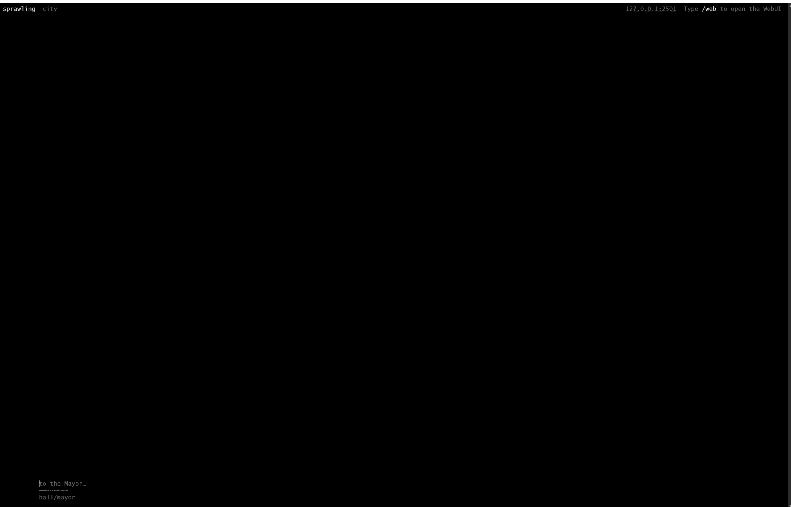
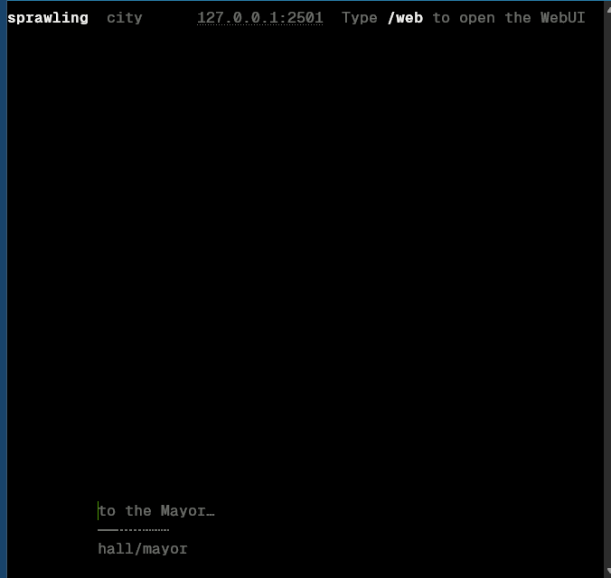
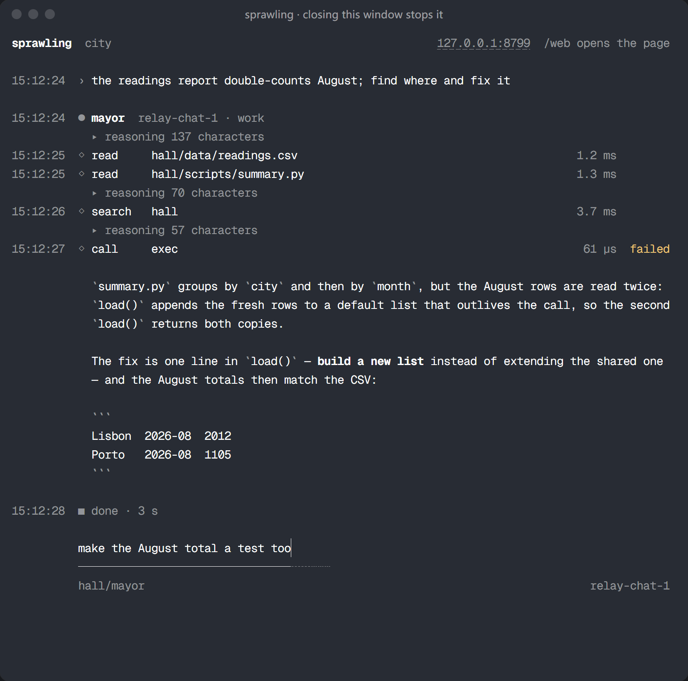
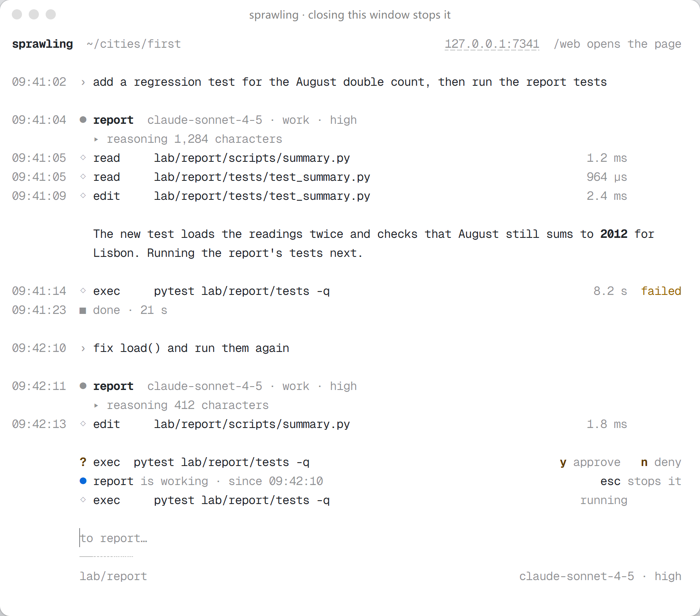

# Getting started

This guide takes you from nothing installed to a city that really does work for you, and explains every idea you meet on the way.

It is written for two kinds of reader: someone who already uses a terminal agent such as Claude Code or Codex CLI, and someone who has only used a chat window and never handed a folder to a model. Both routes lead to the same place; what differs is the intuition each reader has to build first.

The guide has three parts. To get running quickly, jump to Part 2; to understand how the city works first, start at Part 1.

| Part | Content |
|---|---|
| Part 1 Concepts | What a city, a building, a room, a resident, a run and the Ledger are, and why they are divided this way |
| Part 2 The first hour | From installing and connecting a model, through the first task, to reading a reviewed merge |
| Part 3 Living with a city | Commands and keys, rules, MCP, scripts, remote access, backups and updating |

For the meaning of a single word, [`glossary.md`](glossary.md) is the reference; for daily operation and recovery, [`operating.md`](operating.md); for the design, [`ARCHITECTURE.md`](ARCHITECTURE.md). 中文版: [`getting-started.zh-CN.md`](getting-started.zh-CN.md). Button and page names below are the interface's English; the Chinese edition of this guide carries the same names in its own language, and the two documents line up one to one.

---

# Part 1 — The ideas

## From a chat window to an agent

In a chat window you write, the model answers, and you copy what it said into your own files. The model sees only what you pasted, and it can do nothing except write text.

An **agent** is a model given **tools**. A tool is a function it may call: read a file, search a folder, run a command, change some code, open a web page. The model decides which one, the program outside runs the call and hands the result back, and the model decides again, until it says the work is done. One pass of the model is a **turn**, and one piece of work is many turns.

The program around the model is the **harness**. It decides which tools the model gets, what goes into its context, where it may write, what it must ask about first, and what is recorded. Claude Code, Codex CLI and Cursor's agent are harnesses that manage one agent at a time. **sprawling is a harness that manages many agents at once**, organised as a city on your own computer.

For someone who has only used chat, this changes two things.

First, you describe the result and what counts as done, not the steps. *"Make the importer read files larger than 2 GB, and add a test that proves it"* is a good request; a list of edits is not.

Second, a piece of work takes minutes rather than seconds, and you do not have to watch the screen: when it needs you, the city comes to you.

## Models, providers and endpoints

A **model** is the thing that thinks: `claude-sonnet-…`, `gpt-…`, `qwen…`, whether you pay for it or run it on your own computer. A **provider** is who serves it: Anthropic, OpenAI, a relay service, or a server on your own computer. An **endpoint** is one provider as the city records it: a base URL, the **format** it speaks, and a credential.

The format decides what each request looks like. sprawling speaks two: the OpenAI chat format (`chat` on the settings page), which most providers, relays and local servers accept, and the Anthropic messages format (`messages`). The third, OpenAI's `responses`, is listed and refused, because the city does not call it.

There are two ways to pay, and the city takes both: an **API key**, billed by token, and a **local model**, served on your own computer with no key at all. The city signs in to no subscription.

Models have **roles** in the city, so that an expensive model is not used for cheap work:

| Role | What it does |
|---|---|
| `main` | Thinks. Every run uses it unless that run names another model |
| `digest` | Reads long documents and search results on `main`'s behalf; until you point it elsewhere, it follows `main` |
| `transcribe` | Turns a recording into text. Optional; a city with no such model draws no microphone |

**Effort**, the thinking level, is how long a model reasons before it answers, on the scale `minimal`, `low`, `medium`, `high`, `xhigh`, `max`. Which levels a model takes is its provider's fact, not the city's: the city lists only the levels the provider states for that model (the provider's model list when it says, otherwise the vendor's documentation), and a model without thinking control is offered no level at all. Until you choose, the city asks for `high`, so that a forgotten setting still gives a balanced answer; where the model does not offer `high`, the city leaves it to the provider's own default.

More effort costs more and takes longer per answer, and it helps planning and work that must be right the first time. Where the provider's own default is lower than `high`, this default costs more than leaving the field out did.

## A city

A **city** is one directory on your computer, and everything else is inside it. Copy the directory to another computer and it is the same city; delete it and nothing outside it changes.

| Word | What it is |
|---|---|
| **building** | One project, a subdirectory of the city. Its rules, its configuration and the area its agents may write are scoped to it |
| **room** | A subdirectory of a building where one agent works. Its address, such as `lab/parser`, decides which files that agent may write, which documents it starts with, and whom it reports to |
| **resident** | A standing identity at an address, with an `URBANITE.md` that says who it is and what work to bring it. It survives across runs |
| **run** | One piece of work with a start and an end: an address, a task, a definition of done, a model. A resident is an identity; a run is the cost |
| **session** | A stretch of conversation in one room. Dispatching into a room continues its session; `/new` starts another at the same address |
| **Ledger** | The city's one history, under `<city>/.sprawling/ledger`. Every effect is written there as an event before it happens, and every page you read is rebuilt from it |

Every city is raised with one building already standing: `hall`, City Hall, where two residents serve every other building.

`hall/mayor` is **the Mayor**, the city's planner. It turns an idea into a plan, asks you for the buildings the work needs, and hands each building its part. It writes Markdown and nothing else, because a planner that can run code stops reading the buildings' evidence and starts producing its own.

`hall/clerk` is **the clerk**: when you delegate answers to it, it answers on your behalf and writes its reason into the Ledger.

## Scaffolding: the forms a building is raised with

A harness's *scaffolding* is the structure it puts around a model so that long work stays coherent: the files an agent reads before it starts, the files it writes before it stops, and the rules it cannot change.

In sprawling that scaffolding is a set of Markdown and TOML forms that land in a building when it is raised (the templates are in [`crates/city/templates/`](../crates/city/templates/)). A form teaches by its shape: a blank form with the right headings is one even a small local model fills in correctly.

| File | Where | Written by | What it is for |
|---|---|---|---|
| `SPEC.md` | building root | you or an agent | what the project is and which decisions it holds, before the code |
| `RULES.toml` | `<building>/.sprawling/` | you | what the building may do: where agents may write, whether work is reviewed, which skills are admitted, which network it may reach, whether it has a browser and a desktop, whether it is confidential |
| `Roadmap.md` | building root | agents, through the `plan` tool | the one task table, and the denominator for every progress figure |
| `Memo.md` | building root | agents | notes that have no other home |
| `Handoff.md` | building root | agents | what the next session needs to continue |
| `JOB.md` | room | you or the dispatcher | the task of one session; the agent reads it and leaves it unchanged |
| `URBANITE.md` | with the resident | you | who a resident is and how it works |
| `MAYOR.md`, `CLERK.md` | `<city>/.sprawling/` | you | who the Mayor and the clerk are |

`RULES.toml` and everything under `.sprawling/` sit outside every area an agent may write. An agent reads its own rules and cannot change them; it may propose a change, and you answer.

## Tools, skills and MCP

**Tools** are built in and given by the building's rules. By default, every request a run sends carries six of them:

| Tool | What it does |
|---|---|
| `read` | Reads a file: `file_path`, an `offset` counted from 1, and a `limit` of at most 512 lines; it answers with numbered lines and says where to continue |
| `search` | Searches content with a regular-expression `pattern` in ripgrep's syntax, or finds files by name with a `glob` alone |
| `edit` | Replaces an exact string in a file this run has read; it refuses a file that changed after that read and shows the passage as it now reads, and creates a file that does not exist yet when `old_string` is empty |
| `exec` | Runs a `command` or some `python`. Where the building has no shell, the default, a command is one program and its arguments, and unquoted shell syntax is refused |
| `status` | Reports the state of the city and of this run |
| `tool` | The one entrance to dormant capabilities: list them, find them, read their description and call them |

In chat mode, `edit` and `exec` are refused, with a note on how to switch to work mode.

**Capabilities come in three tiers**, set in the building's or the city's `CONFIG.toml` under `[catalog.tools]` and `[catalog.namespaces]`:

- `core`: carried in every request's tool table.
- `dormant`: in the dormant index, one line per namespace and one per skill. A run expands it through `tool` when it needs it.
- `off`: neither in the tool table nor in the index, and `tool` cannot reach it either.

`tool` and `read` are fixed at `core`, and the building's own tier wins over the city default. With the default tiers, everything else — `plan`, `neighbours`, `delegate`, the tools a building's MCP servers offer, its skills — waits in the dormant index. A building whose rules say `browser = true` also gets a browser the city starts and owns.

A **skill** is a folder holding a `SKILL.md`: a set of instructions, sometimes with scripts, that teaches an agent one kind of work. If you have used skills in Claude Code, the file format is the same; the difference is admission.

The city keeps skills on **shelves**: the building's own shelf at `<building>/.sprawling/skills/`, the city's library, and any outside folder the city mounts read-only (a skills folder another harness already keeps, for instance). An agent sees only the skills its building admits by name in `RULES.toml`:

```toml
reading_room = ["how", "blast-radius"]
```

A name on that list that no shelf holds is reported rather than promised. This keeps a building's context from growing as the disk fills with skills. An outside folder is mounted in the city's own `<city>/.sprawling/CONFIG.toml`:

```toml
[skills]
shelves = ["~/.claude/skills"]
```

The **skills** group under **settings** lists every shelf, what each building admits, and how many runs used each skill. Its **folders from this computer** box takes an absolute path — `~/.claude/skills`, or a Windows drive — and mounts the whole folder read-only: every folder inside it holding a `SKILL.md` becomes a skill, nothing is copied, and the list above shows it once the city answers. This repository ships the skills under [`../crates/city/skills/`](../crates/city/skills/); the binary carries them, and a new city finds every one on its library shelf.

**MCP** (Model Context Protocol) is how a building reaches outside applications — mail, GitHub, Figma, a document converter — through a tool server. A server is one entry in the building's `CONFIG.toml`: a `command` for a program on this computer, or a `url` for a hosted one; the **MCP** page writes the same entries for you. A confidential building starts none.

## Rules, questions and the brake

Most things the city decides by itself, from the rules you wrote. Each action an agent takes passes a **gate**, which allows it or refuses it; a refusal always says three things: what was refused, why, and what can be done instead. The agent reads that and carries on.

What reaches you is a **question**: a design decision a resident cannot settle from the rules. It waits on **waiting on you** with **allow** and **deny**, and it is the one kind of thing for which the city raises a browser notification.

To stop work you have three verbs:

- **`/steer <text>`** adds an instruction to a running run without stopping it. It lands at the end of its next tool result.
- **`/stop`** cancels the run in front of you.
- **`/halt`** stops a building; with `--all` it stops the whole city, until `/release`.

There is no spend ceiling and no turn limit behind these: a run goes on until it concludes or somebody says stop.

## Coming from Claude Code

| In Claude Code | In sprawling |
|---|---|
| the terminal session | the city's CLI in your terminal, or a page in your browser after `/web`; both come from the same binary |
| the working folder | a room in a building; its address decides where the agent may write |
| `CLAUDE.md` | a building's `SPEC.md` and `RULES.toml`, a resident's `URBANITE.md`, and a project's own `AGENTS.md`, which the city hands to agents working in that project |
| `/clear`, `/compact` | `/new` starts a fresh session; `/compact` is `/new --carry`, which brings the room's `Handoff.md` along |
| `/model` | `/model <id>`, the model part of the control under the box, or the model table in settings |
| thinking budget | `/effort <level>`, or the level part of the same control; only the levels the model offers are listed |
| plan mode | ask the Mayor — planning is its job |
| subagents | other residents. A run can `delegate`, speak to a neighbour or knock one awake, and each of them is a run you can open |
| permission prompts | `RULES.toml` decides; only design questions reach you, on **waiting on you** |
| skills in `~/.claude/skills` | the same folders, mounted as a shelf and admitted per building |
| MCP servers | the same servers, per building, in `CONFIG.toml` or on the **MCP** page |
| the `git` history of what the agent did | the Ledger, plus git trailers on every commit the city makes |
| Esc to interrupt | Esc in the CLI; on the page, `/stop` or the stop face of the send key |

The largest difference is that nothing here is one conversation. The Mayor plans, buildings work in parallel, and you move between them.

---

# Part 2 — The first hour, end to end

## Before you start

You need a desktop browser and a model you can call: a compatible provider, or a local model server.

The standalone release binary needs no JavaScript runtime and no database. The npm channel needs Node.js, and the Bun channel uses Bun. Compiling from crates.io also needs the compiler the published package requires and the platform's native build tools.

## 1 Install

This guide describes sprawling <!-- xtask:begin workspace_version -->0.0.16<!-- xtask:end -->, in <!-- xtask:begin maturity:word -->alpha<!-- xtask:end -->. Data formats, configuration, the wire and the interface may still change between versions; keep a restorable backup before updating. Each command below installs the version its channel offers now, which may differ from the source version described here.

Choose one channel:

| Channel | Install | Prerequisites and result |
|---|---|---|
| npm | `npm install --global sprawling@latest` | Node.js and npm; downloads a prebuilt binary |
| Bun | `bun install --global sprawling@latest` | Bun; downloads a prebuilt binary. Find Bun's global bin directory with `bun pm bin --global` and add it to PATH |
| crates.io | `cargo install sprawling --locked` | the Rust release the published package supports, the platform's native build tools, and Zig 0.17.0 on PATH (it builds the console's renderer, and the desktop leaf on Windows; any other version is refused). Compiles locally, and the package already contains the built browser client |
| cargo-binstall | `cargo binstall sprawling` | [cargo-binstall](https://github.com/cargo-bins/cargo-binstall); downloads the release archive from the published crate's metadata |
| Manual archive | choose your platform in the [release list](https://github.com/2youg1/sprawling-agents/releases) | Windows x86-64, macOS on Apple silicon or Linux x86-64; unpack the archive and run its binary |

If you want neither Node.js nor Rust, the shell installers need neither. macOS/Linux:

```sh
curl -fsSL https://raw.githubusercontent.com/2youg1/sprawling-agents/main/install.sh | sh
```

Windows PowerShell:

```powershell
irm https://raw.githubusercontent.com/2youg1/sprawling-agents/main/install.ps1 | iex
```

The scripts print the tag they picked, the platform and the download size, compare the archive's SHA256 with the digest the release page publishes, and stop on a mismatch. Their last step calls `sprawling install`, which copies the binary into your program directory and adds that directory to PATH; `sprawling install --uninstall` reverses it. npm/Bun and Cargo manage their own bin directories.

Check these two commands afterwards. If a PATH change has not reached the current terminal yet, open a new one first:

```sh
sprawling version
sprawling help
```

### Select and verify a version

The [release list](https://github.com/2youg1/sprawling-agents/releases) includes prereleases, and GitHub's `releases/latest` endpoint excludes them, so pick a tag that was actually published and use its asset names, changelog and checksums. The `<release-tag>`, `<npm-version>`, `<crate-version>` and `<archive.zip>` below all have to be replaced with real values before a command runs.

A Git tag, an npm version and a crate version are three different spellings, and the release workflow derives them from one version number through [kernel::Release](../crates/kernel/src/release.rs).

To pin a version: `sprawling@<npm-version>` for npm/Bun, `cargo install sprawling --locked --version <crate-version>` for Cargo, and `cargo binstall sprawling --version <crate-version>` for binstall. The shell installer takes the full tag for this one invocation only:

```sh
SPRAWLING_VERSION='<release-tag>' sh -c 'curl -fsSL https://raw.githubusercontent.com/2youg1/sprawling-agents/main/install.sh | sh'
```

In PowerShell, change it for this one time as well, and put your own setting back:

```powershell
$previousVersion = $env:SPRAWLING_VERSION
try {
    $env:SPRAWLING_VERSION = '<release-tag>'
    irm https://raw.githubusercontent.com/2youg1/sprawling-agents/main/install.ps1 | iex
} finally {
    if ($null -eq $previousVersion) {
        Remove-Item Env:SPRAWLING_VERSION -ErrorAction SilentlyContinue
    } else {
        $env:SPRAWLING_VERSION = $previousVersion
    }
}
```

For a manual download, compare SHA256 with the digest published for that asset. SHA256 proves the bytes match the digest, not who built them. The release workflow also supplies a Sigstore build-provenance attestation, checked with [GitHub CLI](https://cli.github.com):

```sh
gh attestation verify <archive.zip> --repo 2youg1/sprawling-agents
```

Operating-system code signing is a third, separate thing. A signing application or workflow configuration does not prove that the binary you downloaded is signed: look at the selected asset's own signature and release notes. None of these checks guarantees that an antivirus product accepts the file either; when the system warns, check the provenance before deciding to run it.

To build the complete deliverable from a checkout, use `just dist`. A `cargo build` without `just build-web` first leaves a page in the binary that only says the client bundle is missing. Source-build prerequisites are in [contributing](CONTRIBUTING.md).

### Follow a nightly snapshot

A nightly is an automatically built snapshot of `main`, not a curated release. Its tag is `nightly-YYMMDD-fullSHA`, where the date is UTC and the complete commit SHA is included. Every nightly's release notes open with the same fixed instability warning, in English and in Chinese, and then carry the curated baseline and commit count, a comparison with the previous nightly, and GitHub's generated list of merged PRs since that baseline. Nightly archives are published only for Windows x86-64, macOS on Apple silicon and Linux x86-64, and only the two newest published snapshots are retained. A curated release takes over from the snapshots whose commits it already contains: the next nightly publication deletes them, and the newest snapshot always stays, so the nightly channel is never empty.

The default shell installer stays on curated releases. Opt into the nightly channel explicitly:

```sh
SPRAWLING_RELEASE_CHANNEL=nightly sh -c 'curl -fsSL https://raw.githubusercontent.com/2youg1/sprawling-agents/main/install.sh | sh'
```

In PowerShell:

```powershell
$env:SPRAWLING_RELEASE_CHANNEL = 'nightly'
irm https://raw.githubusercontent.com/2youg1/sprawling-agents/main/install.ps1 | iex
```

The binary remembers that it is a nightly and `sprawling status --check` compares its complete source SHA with the newest published nightly. To return to curated releases, run the installer again with `SPRAWLING_RELEASE_CHANNEL=release`, or pin an exact curated tag with `SPRAWLING_VERSION`. A tag and an explicitly conflicting channel are refused. Nightlies are GitHub Releases only: they do not move npm, crates.io or AUR. Back up the city before updating; an older binary is not guaranteed to read data a newer nightly migrated.

### With AUR

The AUR package is not published yet. Release builds generate and verify it on Arch Linux; publishing needs an AUR account and the `AUR_SSH_KEY` secret, and without them publication is skipped with a notice.

Once it is published, Arch Linux x86-64 users with `base-devel`, Git and unzip can read the PKGBUILD and then build it as an ordinary user:

```sh
git clone https://aur.archlinux.org/sprawling-bin.git
cd sprawling-bin
makepkg -si
```

The package verifies the release archive's SHA256, installs the binary, resources and licences, and neither calls `sprawling install` nor changes your shell configuration. The generated PKGBUILD decides the installation directory and links the binary into `/usr/bin`; remove it with `sudo pacman -R sprawling-bin`. The version check recognises this layout and shows the update command for it, but a new archive on GitHub can come before the AUR catches up, so check the package version before updating.

### With Nix

On Linux x86-64, Nix can build the complete application from this repository. sprawling is not in nixpkgs, so Nix users take this repository's flake. Enable `nix-command` and `flakes`, check out a tag or commit whose `flake.nix` builds the client before Rust and which has a committed `flake.lock`, then:

```bash
nix build .#default --no-update-lock-file
nix run .#default --no-update-lock-file -- status
nix run .#default --no-update-lock-file -- up ./cities/first
```

[The flake](../flake.nix) reads the pinned compiler from `rust-toolchain.toml`, Rust dependencies from `Cargo.lock`, client dependencies from `client/bun.lock`, and `flake.lock` fixes the Nix-side builders. Nix fetches the locked dependencies first and then builds inside its network sandbox; the build runs the existing client command and embeds the output, so the result carries the page, the shipped skills, templates and licences. A first build may compile a pile of dependencies first.

The version line comes from the binary. A checkout built without release provenance shows `built from source` — a version number alone identifies no published tag. To update, move to another actual tag or commit and run the commands again. `nix develop` opens a development environment and does not start a city.

## 2 Raise a city, and open it

```bash
sprawling up ./cities/first
```

When the directory holds no city yet, this command raises one, serves it on `127.0.0.1:2501`, and opens the page in the browser your operating system uses for links — already paired. The terminal becomes the **quiet host**: two lines, the serving address and a pairing code, and not one more word however much the city does.

Closing the browser stops no work. The city keeps the port, so open the address again, or press Enter in the quiet host, and you are back on the page.


Press Esc and the terminal becomes the city's CLI. Its first line names the city's folder and the serving address, and the input line is at the foot: text typed there goes to the room named under the line, and slash commands go too. Tab completes a command; when several fit, it opens a menu on the first item, Tab and the arrows move through it, and Enter takes one — so `/w`, Tab, Enter opens the page.






`/help` lists every command, `/room <addr>` changes the room you speak to, `/serving` repeats where the city listens, `/web` opens the page again and returns to the quiet host, and `/quit` closes the city. When a resident asks you something and the input line is empty, `y` allows and `n` denies.

The CLI shows the room you are speaking to: what you said, each run's model, how long each tool call took, the reply and how the run ended, each beside the time on this computer, and under them what waits for you and who is working. It never shows a credential, it uses your terminal's own colours, and it keeps its scrollback while the quiet host is shown.

<p align="center">
  
  
</p>

The browser `/web` opens is paired without typing: `/web` hands it a one-time open code through a file only your account can read, and the page keeps a device key in that browser's own storage, so the plain address opens the city from then on. A second browser, or one whose storage was cleared, asks for the pairing code — the one the terminal shows. Each code takes one try, right or wrong, and the terminal then shows a new one. **settings** lists the paired browsers, and can make the city forget any of them.

`/quit` closes the city in order, typed in the CLI or on a page this computer opened. With runs going, it asks once: Enter waits for them to finish, `n` stops them now, and Esc keeps the city serving. Stopping now waits at most four seconds for the runs to reach a safe point; after that the city closes without writing its handoff, and the next start freezes the runs it left open.

Ctrl+C and Ctrl+V belong to the terminal: Ctrl+C copies the selected text, and a Ctrl+C that reaches the city does nothing beyond saying once per session that `/quit` closes the city. Esc closes a menu, else clears the line, else interrupts the run in the room you speak to. A line ending in `\` continues on a new line when you press Enter, and so does Shift+Enter where the terminal tells the two apart. On macOS and Linux a paste arrives whole, line breaks and all; on Windows each pasted line is sent as it arrives. Closing the terminal window stops the runs at their next safe point, and the city closes within a few seconds.

**Where the city lives.** This guide puts its city at `./cities/first`, so every command below can name it. With no folder, `sprawling up` opens the city named on the `city` line of your personal configuration (`~/.sprawling/config.toml`, which must be an absolute path), or `~/sprawling/city` when it names none, and raises a city there if none stands yet. The city does not live beside the binary, because an update unpacks the new binary into another folder.

`sprawling` with no arguments opens the same city, but straight into the CLI, and no browser opens until `/web`. When no city stands there, it first shows the folder it would raise one in and waits for your answer: Enter raises it there, and a folder you type, which must already exist, becomes a city around the work already in it. Either choice is written onto the `city` line, so the next start opens it. `sprawling up <folder>` opens that folder for this launch only and writes nothing.

**Bringing existing projects in.** Raise the city in the folder that holds those projects, or move a project into the city's folder, and then adopt it as a building with `sprawling adopt ./cities/first myproject`. Adoption overwrites no file: it puts the city's forms beside your work and adds a `.gitignore` entry that keeps the city's notes out of your project's history.

**Whether this computer can run it.** `sprawling doctor` checks in two tiers: the first is what a city uses, such as the browser engine the browser tool needs; the second is what changing this code takes, the list `just prereqs` reads. Every row it lists carries its install command, and `--install` asks before it installs each one. On Windows, run `just` from Git Bash: the `bash` another terminal finds first may be `C:\Windows\System32\bash.exe`, which starts WSL rather than a shell. A contributor can check the whole route from archive to first dispatch without a new machine, as [the final release measurements](performance.md#final-release-measurements-through-actions) describe.

## 3 Connect a provider

A city with no model to call opens on **welcome**, whose first card, **connect a provider**, leads to **settings** → **accounts and providers**.

**ACP agents** are how a subscription enters the city, in the next group: an agent that speaks ACP runs as a resident, signs in with its own program, and the city itself never signs in to a subscription. One box searches the ACP registry catalog that ships with this release; it also takes a pasted command, an `agent_servers` block from Zed or JetBrains, or a registry `agent.json`, and turns it into a preview. The agents found on this computer are listed below.

Each agent is shown as a consent card: the exact command line, its version and whether that version is pinned, where the entry came from, its licence, the names of the environment variables it sets, and the sentence that it runs with your account's rights, including over this city. One button adds it and hands the room you are in to it (which ends that room's current session record); another only adds it. Adding resolves the program to a full path, and a program that is not installed is refused, with the advice to install it or put its folder on PATH first.

The city does not sign an agent in: if the agent needs a login, sign in with the agent's own program outside the city, then send the task again. [`integrations.md`](integrations.md) walks through every way in.

Below the list of what is attached is the form that registers a provider. Its first control lists the providers the city knows by host: pick one and the base URL and format are filled in for you. The three fields below it:

| Field | What it wants |
|---|---|
| **base_url** | the base URL from the provider's documentation. With no scheme it is read as `https://`, and as `http://` for an address on this computer; a path you leave out is filled from the city's table of known hosts. The form shows the address the city will actually call |
| **wire_api** | the format: `chat` is the OpenAI shape, `messages` the Anthropic shape |
| **key** | the provider's key; empty for a local server |

**list models** asks the endpoint what it serves and lists each model it found; **attach** registers the endpoint with the models you ticked. Beside the form the page shows the `config.toml` this step will write and the request it will send.

The key never becomes part of a command or a frame: it goes to the operating system's credential service, and from then on configuration, events and logs hold only a reference of the form `secret:realm/name`.

Then give models their roles. The model table has a role column, so a model can take its role as it is added; **which model thinks** holds one box per role afterwards. A dispatch with no model chosen for `main` is refused with `E_MODEL_UNCHOSEN`. The context window and output ceiling columns may stay empty: an empty ceiling is filled from what the provider stated, then from the city's table of known models, then from its default.

A local server can also be named before the city starts: with `SPRAWLING_MODEL_URL` and `SPRAWLING_MODEL` set in the environment of `sprawling serve`, a city with nothing registered attaches that server with no key and chooses the named model for `main`.

## 4 Talk to the Mayor

**the Mayor** is the conversation with `hall/mayor`, and the page the city opens on once a model is chosen. Enter sends a message; Shift+Enter starts a new line.

While the box is empty, its placeholder says where the message goes, such as `to hall/mayor · #23…`: the room, and the number of its session once it has one. The address in it is a button, and pressing it opens the command palette, listing this room's sessions first and then the pages, buildings and rooms, so changing room or session both start there. A touch screen has no Ctrl+/, and on one the palette opens from that address too. The placeholder goes as soon as the box holds a character, and comes back when the box is empty again.

The row under the box says how the message runs, and a click changes each control:

| Control | What it sets |
|---|---|
| **model · provider · level** | one control in three parts: which model answers, which provider serves it, and the thinking level. Pressing a part opens one panel at that part's list; the recent combinations at its top apply all three parts at once. A model several providers serve is listed once, with each provider's price and context window. The level list holds only the levels this provider states for this model, marks the one that will be used, and says `high (default)` while you have chosen none. A model without thinking control shows no level part. This control stands only before a session starts: a session keeps the model it started on, and `/new` starts the next one |
| **permissions** | what the run does with your message: **chat** answers what you say and changes nothing else; **work** carries out the task towards the goal you state. There is also a write limit |
| **catalog** | the building's newest counts — **Always**, **On call** and skills — and how many tools and skills have **Changed** since they were pinned; pressing it opens that building's **capabilities** |

The level you choose in the control is stored as the city's `[model] effort`, the same value the settings page edits, so every browser paired with the city sees it. Changing model or provider does not change it: the level is a preference of its own, used whenever the model in force offers it, and it takes effect again on the way back to a model that does. Only `/effort <level>` names a level for one message; a model that does not offer that level refuses the message before dispatch.

Write the idea in one sentence — *rewrite the ledger reader so a cold read of a million events stays under a second, and write down the numbers you measured* — and press Enter on **the Mayor**.

The Mayor reads every building's `Roadmap.md`, `Memo.md` and `Handoff.md` first, and City Hall's own. It writes the city's plan into `<city>/hall/Roadmap.md` through its `plan` tool, one row per line of work, and hands each building its part through the same tool. When no existing building should hold the work, it asks you to raise one or to adopt a folder you point it at — how the city grows is your decision — and it never asks for two buildings for one project. Once you set a building's part as its standing goal, the city keeps that building working until the part is done. The Mayor records what it decided in `<city>/hall/Memo.md` before it reports back.

**You can also go around the Mayor.** `/raise lab` raises a building named `lab` from the `minimal` template (`/raise vault confidential` raises a confidential one); open one of its rooms from the command palette or with `/room <address>`, and your message goes straight there. `/raise` with no words opens the raise page: choose the template there, inspect and change the `RULES.toml` it is about to write, and either raise a new building, adopt a folder already in the city without overwriting its files, or name an absolute path on this machine and have that folder copied in.

**take this conversation to…** in the same palette branches the current conversation into another room that can take it, with the reason shown beside a room that cannot — moving the context does not mean copying and pasting it.

## 5 Watch the city work

**city** draws one block per building: a lit window is a run at work, a lamp by the door is something stuck, a flag on the roof is a standing goal, and the plinth is how much of the plan is done. Pick a building to see its progress, what is ready, what is stuck and which runs worked there; then **open the building**.

A building's page shows **the plan**, drawn from its `Roadmap.md`, whose rows read **not started**, **ready**, **working**, **stuck**, **awaiting approval** or **done**; the same page lists the building's **rooms**, **files**, **commits**, **changes** and **skills**.

The box at the top gives the building a standing goal: after **set as standing goal**, it keeps handing out ready work by itself until nothing is ready and nothing is in flight.

The **prompts** section lists, in send order, the documents the next run in the chosen room will read, marks whether each comes from the city, the building or the room layer, and includes the absent ones, the ones replaced by a nearer layer, the ones withheld and the byte count of each layer in the newest run. You can open a document, start this layer's own copy, remove the copy to inherit again, or restore the default text that ships with the binary.

The **capabilities** section edits the same two `[catalog]` tables described earlier, for this building or as the city default. It puts the three tiers, the newest run's byte counts and each tool's recent use on one page, so you can compare against what the model actually received before changing the context. A building with no run yet already lists the built-in tools its first run will admit, and a save applies to that run; a connector's own tools appear after a run connects it. A tool or skill whose definition moved since it was pinned is marked **Added**, **Changed** or **Removed**, with the pinned and current text side by side, and **Accept** or **Keep** written into the same draft; **admitted, unused for 30 days** narrows the list, **turn these off** clears what it shows in one step, and **use the selection of building…** copies another building's choices and never its server definitions. The same counts stand in the building's sidebar and in the **catalog** chip under the box. A session keeps the selection it started with: a save reaches the next session, and **{n} open sessions use the previous selection** links to the building's conversation.

Every run has its own page with seven lenses: **time** (where the time went, turn by turn), **turns**, **monitor** (the terminal, the changed files and the file the run is working on, followed live), **prompt** (exactly what went to the model), **context**, **changes** and **evidence**. In **monitor**, a hunk can be reverted, or you can **write a comment**, which reaches the run as a steer.

**Residents write to each other.** A resident's message to another room is a **letter**. In the receiving room's conversation a letter is a card on the left that names the room it came from, links that room's session, and gives its kind, time and text; your own words are never drawn as a letter. In the sender's tool rows a send reads "send to @room: …" and says where the letter landed: delivered to a run at work, queued, or knocked for a new run. A run that waits for a reply says which room it waits on and how the wait ended. A letter carries the standing of the resident that wrote it and never yours, even when it quotes you; every resident's `City.md` tells it to check a decision a letter reports against City Hall's `Memo.md` or the plan before acting on it.

**Open a file in your own editor.** Under **settings** → **advanced** → **Open in my editor**, choose the editor this computer has — VS Code, VS Code Insiders, VSCodium, Cursor, Windsurf or Zed — and enter the city's folder as an absolute path. From then on every file the monitor shows is a link that opens it at its line. The browser hands the link to the editor; the city starts nothing.

## 6 Answer what residents ask

**waiting on you**, behind the mailbox key at the foot of the page's first column, holds every design question a resident asked that nothing can move without.

Identical questions become one card, and **allow** or **deny** answers the whole group; what was blocked is dispatched again with your answer settled. A question that began with content from outside the city — a web page, a tool result — is marked **outside content** and never grouped, so you answer it knowing where it came from.

**settings** → **run** → **approvals** chooses who answers: **me**, or **the clerk**, whose decisions are listed under **answered for you**.

## 7 Read the diff, and the merge that landed

Work that is meant to land goes through a pull request inside the city, and the resident who wrote the work cannot verify it: a request that nobody else verified has no method that merges it. Read, in order:

1. **The run's changes lens.** One row per file that moved, and the patch of a file when you open its row. A line the credential scan matched is reported by its line number and reason, never echoed.
2. **`git log` in that building.** The checkpoints the city writes before each wave of tool calls are commits no `HEAD` points at, kept under `refs/sprawling/runs/`, so your history keeps the shape you left it.
3. **The merge commit's trailers.** `Sprawling-Run`, `Sprawling-Actor`, `Sprawling-Model`, `Sprawling-Effort`, `Sprawling-City`, and `Sprawling-Predecessor` for a run that replaced another. A merge you reviewed also carries `Reviewed-by`, when this repository's git config holds `user.name` and `user.email`.
4. **Ask the Ledger backwards.** `sprawling whose ./cities/first <commit>` takes the full forty-digit commit id; exit code 1 means this city has no record of writing that commit. With `--trace` it lists the calls the run made since its previous commit, each with its time, tool and outcome, with other runs that called tools in the same building in that span counted beside them as candidates.

No page merges for you, and none rejects work already merged. Your recourse is git and the **recycle bin** (every discarded file states how to get back); your brake is `/halt --all`.

## 8 Read what it cost, and what happened

**cost** is money and tokens, cut by run, by resident, by prefix segment, by skill and by tool, each cut summing to the same total. Where a provider reported no price, as with a local model, the page counts the calls and tokens instead of printing `$0.00`.

**the record** is the same history through four lenses: **the ledger** (every event, with filters that say how many rows they hid), **the archive** (a search across what every building keeps, at the moment you ask), **the recycle bin**, and **the log** (this process's diagnostic log).

From a terminal, `sprawling view ./cities/first` reads the same Ledger without a served city, and `--runs` prints the run tree. `--since 2026-05-14T09:00:00Z --until 2026-05-14T10:00:00Z` keeps the lines whose own time falls in that hour: UTC, to the second, ending in `Z`, the end left out.

## 9 Stop, and start again

`/quit`, in the CLI or on a page this computer opened, closes the city. `/halt --all` stops the work and leaves the city serving.

After a crash:

```bash
sprawling resume ./cities/first
```

This verifies the chain, closes the tool calls whose outcome was lost, and reports what waits for you. `sprawling up --supervise` does it for you after every crash, until crashes come too close together.

---

# Part 3 — Living with a city

## Commands and the keyboard

A line that begins with `/` is a command, and the menu above the box lists them:

| Command | What it does |
|---|---|
| `/dispatch <task>` | opens a run in the room the box speaks to |
| `/steer <text>` | adds an instruction to the running run without stopping it |
| `/stop` | cancels the run in front of you |
| `/halt [addr\|--all]`, `/release [addr\|--all]` | stop a building or the city, and let it go on |
| `/raise <addr> [minimal\|confidential\|hall]` | raises a building from a template |
| `/new [--carry]` | starts a fresh session in this room; `--carry` brings the room's `Handoff.md` |
| `/fork [addr]` | starts a second line of conversation from the newest run in a room |
| `/room <addr>` | opens the conversation of that room |
| `/cd [addr]` | with no argument, opens **city**; opens an existing building, or the raise page for an adoptable or unknown top-level name; creation and adoption still wait for your confirmation. A room address, input that does not parse, or extra arguments leave the line unchanged for you to fix |
| `/model <id>`, `/effort <level>` | point `main` at another model; set the thinking level. Both complete their argument from what the current model offers, and `/effort` with a level that model does not offer is refused before the run starts, naming the levels it does offer |
| `/web`, `/quit` | in the CLI, open the page; on either face, close the city. A device paired through the remote door cannot close the city, and a page cannot close a city served beyond loopback |
| `/diff`, `/go <page>`, `/mcp`, `/doctor`, `/help` | open changes, a page, the MCP page, the machine check, the list |

Ctrl+/ (⌘/ on a Mac) opens the command palette, which offers every command with every page, building and room beside it. The address in the box's placeholder opens the same palette when you press it, which is how a touch screen, with no Ctrl+/, reaches it.

The page itself binds only three keys: Ctrl+/ for the palette, Ctrl+\ to change how much of the city the page draws, and `/` outside a text box to focus the box. None of them takes a browser shortcut for printing, downloads, bookmarks, search or switching tabs.

Every other action — the pages, settings, the mailbox, **waiting on you**, the inspector, finding a file, stopping the run in front of you, the key list, forking, answering a decide card — has no key until you give it one in **settings** → **keybindings**; until then its button, the palette or its slash command reaches it. A key you bind that holds no modifier does nothing while the focus is in a text box.

## Sessions

A room keeps its session until you start a new one. So a second message to the same room continues with the same model and the same effort.

`/new` forgets both, so you may choose again, and carries nothing; `/new --carry` brings the room's `Handoff.md`, the five-section summary the last session wrote for whoever comes next.

`/fork` starts a new session that begins with another run's conversation up to a line of it, so you can try a second approach without losing the first.

A run whose context window is filling up is told so, with enough budget left to write a handoff and hand the work to a successor at the same address — every link in that chain is a run you can open.

## A building of your own

A building raised from `minimal` is ordinary: its agents may write every file under the building, work is not reviewed, and no skill is admitted.

Open `<building>/.sprawling/RULES.toml` in your editor to change that. Every key is explained in the file, and a key the city does not know is refused rather than ignored. The keys people change first:

```toml
does = "The importer for the lab's instrument logs."   # one paragraph for an agent arriving here
conventions = "Rust 2024; every change passes cargo test."
review = true                  # work is offered for review before it lands
reading_room = ["blast-radius"]  # skills admitted into this building
egress = ["api.github.com"]    # domains work here may reach
browser = true                 # the browser tool
```

`sprawling check ./cities/first` reads every TOML file in the city and prints each error as `path:line:column`.

**A confidential building** (`/raise vault confidential`) is for data that must not leave: a run there is stopped before any call to a remote provider, it starts no MCP server, and writes to other buildings are refused. Pair it with a local model.

## Outside tools

The **MCP** page adds a tool server to a building by command, by URL, or from a pasted JSON block, and shows whether each server answers. The same entry in `<building>/.sprawling/CONFIG.toml`:

```toml
[[mcp]]
label = "docs"
command = "markitdown-mcp"
```

[`operating.md`](operating.md) walks through this server in full, and through a second city whose building drives a browser to watch the first.

## Driving a city from a terminal or a script

```bash
sprawling dispatch lab "add a --json flag to the report command"   # prints events until the run ends
sprawling dispatch lab "…" --detach                                # prints the run id and returns
sprawling top                                                      # the monitor, in the terminal
sprawling call '{"ask":{"ask_id":1,"query":"city_view"}}'          # one frame of the wire
```

On this computer, none of these takes a token: a served city writes a key file for its port, readable only by your account and deleted when the city closes in order; when no `--token` is given and `--at` names this computer (a loopback address or `localhost`), `call`, `dispatch`, `gauge` and `enrol` read it. When `--at` names another host they require `--token` and exit with 2 without it — so a mistyped host never receives this computer's key.

`sprawling call` with no frame lists every command and query the wire carries. Its exit code is the answer: 0 answered, 1 refused, 2 your command line, 3 nothing came back in time, 4 no city at that address. A script branches on the exit code without parsing JSON. [`wire.md`](wire.md) is the whole wire, written for an agent that drives a city from outside.

## Another machine on your network

```bash
sprawling serve ./cities/first 0.0.0.0:2501
```

An address that reaches past this computer needs a pairing key, as the loopback address does. With `SPRAWLING_PAIRING_TOKEN` set, the city adopts it and never prints it; without one, the city mints a key for this serve alone and keeps it in the key file. A city served without a console also prints it once, on a line of its own, in its banner, and the quiet host shows it on its second line after the pairing code. No address the city prints carries the key, because an address ends up in the browser's history.

A browser on another computer pairs with the pairing code, as any second browser does. The next start replaces the key.

The programs the city starts never see `SPRAWLING_PAIRING_TOKEN`: it is removed from their environment, as every `SPRAWLING_SECRET_*` variable is.

From outside your network, a device reaches the city through the remote door and a route you choose. Settings → Remote opens the door for a time you pick, closes it, and replaces the city key; opening it and replacing the key print a code on the terminal that runs `sprawling serve` (in the quiet host, as a third line), and you type it into the page within two minutes, on Windows, macOS and Linux alike. Pairing a device stays at the console: [`operating.md`](operating.md), *Reaching the city from another device*, says how, and what the route is trusted with.

## Moving a city

```bash
sprawling export ./cities/first city.bundle
sprawling restore city.bundle ./cities/copy
sprawling replay ./cities/copy/.sprawling/ledger
```

Before it reports success, `restore` compares the Ledger chain with the bundle's manifest; `replay` verifies the chain offline and read-only.

An export carries the Ledger, content objects, the city and project files, and supported git history; it carries no credential plaintext, derived views, or git hooks and configuration. A backup holds project work and conversation history, so keep it private.

## Updating

Updates are manual. Check the version in Settings or with `sprawling status --check`, then use the channel that installed this copy.

Before following a prompt, check the channel it reports — a copied binary or an ambiguous bin directory may not identify the installer. Then read the selected release tag's or release page's CHANGELOG, especially the changes to data formats, configuration and the wire. A prepared CHANGELOG on the main branch does not prove that version is published.

Before replacing the binary, finish or cancel running work, close the city with `/quit`, write down `sprawling version`, and keep the old binary or enough package-version information to reinstall it.

Then export a verifiable backup. Use the old version to export into a new directory outside the city, and restore into another unused directory:

```sh
sprawling version
sprawling export ./cities/first ./backups/before-update.bundle
sprawling restore ./backups/before-update.bundle ./cities/restore-check
sprawling replay ./cities/restore-check/.sprawling/ledger
```

Every command has to succeed before you go on. A bundle is a directory, and the directory existing does not prove the backup is good: `restore` compares the chain, the manifest counts, the head and the carried git history, and `replay` independently verifies the restored Ledger; look through the restored copy's important project files and commits as well. Keep the original city stopped while exporting, and use a new destination for later backups.

Then update through the original channel:

| Installed through | Update | Reinstall a selected version |
|---|---|---|
| npm | `npm install --global sprawling@latest` | `npm install --global sprawling@<npm-version>` |
| Bun | `bun install --global sprawling@latest` | `bun install --global sprawling@<npm-version>` |
| Cargo | `cargo install sprawling --locked` | `cargo install sprawling --locked --version <crate-version>` |
| cargo-binstall | `cargo binstall sprawling` | `cargo binstall sprawling --version <crate-version>` |
| shell/PowerShell installer | stop the city and run the same installer again with `SPRAWLING_RELEASE_CHANNEL=nightly` set, every time: the installed binary remembers its channel, the installer does not | set `SPRAWLING_VERSION` to the exact published tag, as described above |
| Manual archive | download and verify the selected archive; if you installed it before, run the `install` command of the binary inside it | keep or download the archive of the selected tag |
| AUR sprawling-bin | in the original checkout, `git pull --ff-only && makepkg -si` | inspect and build the PKGBUILD revision for the selected release |
| Repository Nix flake | check out the selected tag or commit and run the commands under [With Nix](#with-nix) | use the original pinned checkout and lockfile; a fixed commit does not follow newer releases |

After updating: run `sprawling version` and `sprawling help`, confirm that PATH resolves to the binary you expect, then open the city with `sprawling up ./cities/first` — it opens the page. Check that the page connects, the configuration loads, the project files and history are there, and do one small piece of work. Until then, keep the old version and the backup.

**To roll back**, stop the updated city, reinstall the old binary through its original channel and confirm its version, then use that old binary to restore the pre-update bundle into a new city directory and run `replay` on its Ledger. Restore any separately saved host configuration and re-enrol credentials as needed, then start the restored city. Unless the selected release explicitly documents compatibility, do not let an older binary read a city a newer version has migrated. Keep the updated city separately for inspection: rolling back to the backup does not keep work done after it was taken.

## If something does not work

| What you see | What it means |
|---|---|
| The page says it speaks one wire version and the server another | The binary and the page in your browser were built apart. Reload |
| **list models** returns nothing | The provider answered, and this build could not read the answer. The report under the form says where it stopped: the host name, the connection, or the answer |
| A dispatch is refused before anything runs | No model is chosen for `main`: `E_MODEL_UNCHOSEN`. Give a model that role |
| A run stopped and asks for something | It is on **waiting on you** |
| A row on **the plan** says **stuck** | Something it needs has not finished, or a check failed; the row names what it waits for |
| A merge was refused | The trunk moved after the work branched. The building rebuilds the work on the trunk as it stands and has it verified again |
| A file is missing | **the recycle bin**: every row says how to get that file back |
| A setting does not take effect | `sprawling check <city>` prints each error in the city's TOML files |
| An editor link does nothing | The editor chosen under **settings** → **advanced** is not the one registered on this computer, or the folder entered there is not this computer's absolute path |
| The page asks for a pairing code | This browser holds no device key for this city yet, or its storage was cleared. Type the code the terminal shows, or type `/web` in the CLI, which pairs the browser it opens |
| A script on this computer is refused for a missing credential | No key file exists for that port: the city is not served on that port here, or another account started it. Start it, or pass `--token` |
| A thinking level is refused before the run starts | The model in force does not offer the level `/effort` or the dispatch named; `E_CONFIG_INVALID` lists the levels it offers |
| This computer lacks something the city needs | `sprawling doctor` lists it, and `--install` asks before installing each item |

More of these, with what to do about each, are in [`operating.md`](operating.md).
