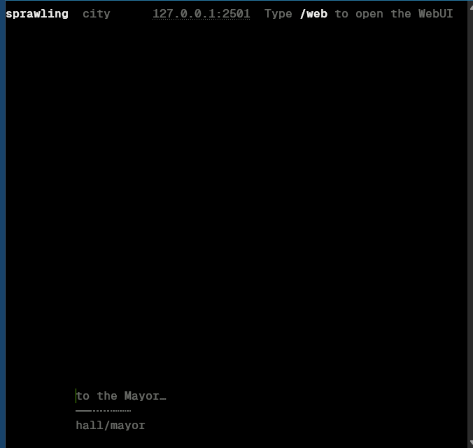
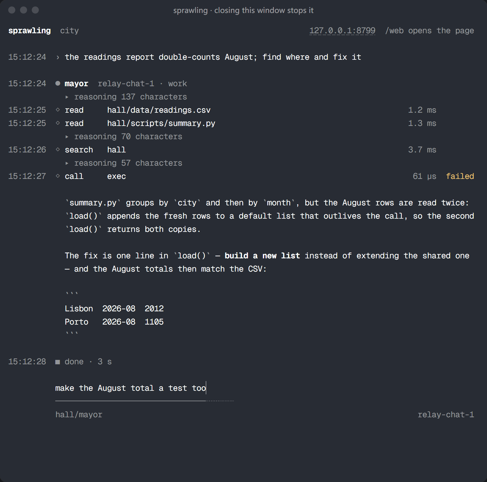
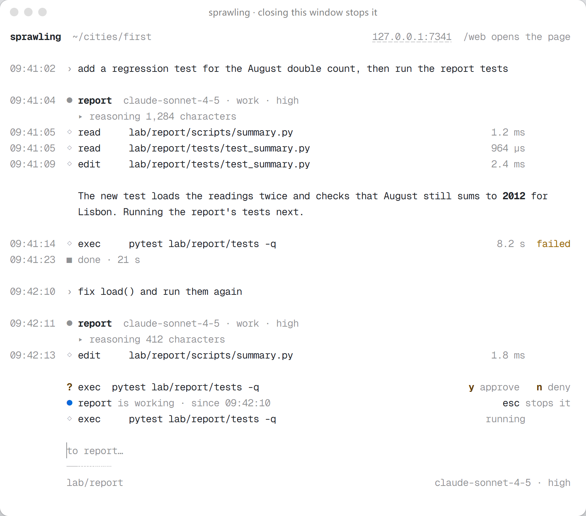

# 上手指南

这份指南带你把 sprawling 从「什么都没装」跑到一座真的在替你干活的城市，路上遇到的每个概念都会讲清楚。

它写给两种人：已经在用 Claude Code、Codex CLI 这类终端 agent 的人，和只用过聊天窗口、从没把一个文件夹交给模型去干活的人。两条路走到同一个地方，只是需要提前建立的直觉不同。

全篇分三部分。急着跑起来，可以直接跳到第二部分；想先弄明白城市是怎么运转的，从第一部分开始。

| 部分 | 内容 |
|---|---|
| 第一部分 概念 | 城市、楼、房间、居民、run、账本各自是什么，以及它们为什么这样划分 |
| 第二部分 第一个小时 | 从安装、接模型、说出第一个任务，到读一次审过的合并 |
| 第三部分 长期相处 | 命令与键盘、规则、MCP、脚本、远程访问、备份与更新 |

查单个词的意思看 [`glossary.md`](glossary.md)；日常操作与出错后的处置看 [`operating.md`](operating.md)；设计看 [`ARCHITECTURE.md`](ARCHITECTURE.md)。English: [`getting-started.md`](getting-started.md)。下文按钮与页面的名字取界面的中文；界面切到英文时，两份文档一一对应。

---

# 第一部分　概念

## 从聊天窗口到 agent

在聊天窗口里，你写，模型答，你再把它说的复制进自己的文件。模型只看得到你贴进去的东西，除了写字什么也做不了。

**agent** 是拿到了**工具**的模型。工具是它可以调用的函数：读一个文件、搜一个目录、跑一条命令、改一处代码、打开一个网页。调哪个由模型决定，外面的程序执行这次调用、把结果交还给它，模型再决定下一步，如此反复，直到它说活干完了。模型走一遍是一个**回合**（turn），一件活是许多个回合。

围在模型外面的那个程序叫 **harness**。它决定模型拿到哪些工具、上下文里放什么、能往哪里写、什么事必须先问、记下什么。Claude Code、Codex CLI、Cursor 的 agent 都是一次管一个 agent 的 harness。**sprawling 是同时管许多 agent 的 harness**，它在你自己的机器上把它们组织成一座城市。

对只用过聊天的人，这带来两点不同。

第一，你描述的是结果和怎样算做完，而不是步骤。「让导入器能读大于 2 GB 的文件，并加一个测试证明它能」是好的请求，一串修改清单不是。

第二，一件活要几分钟而不是几秒，但你也不必盯着屏幕——需要你的时候，城市会来找你。

## 模型、provider 与端点

**模型**是负责思考的那个东西：`claude-sonnet-…`、`gpt-…`、`qwen…`，你付费用调用的、自己在电脑上跑的都算。**provider** 是提供它的一方：Anthropic、OpenAI、某个中转服务，或者你自己电脑上的一个服务。**端点**是城市记下的一家 provider：一个 base URL、它说的**兼容格式**、一份凭据。

兼容格式决定每次请求长什么样。sprawling 说两种：OpenAI 的 chat 格式（设置页上写作 `chat`），大多数 provider、中转和本地服务都接受；以及 Anthropic 的 messages 格式（`messages`）。第三种，OpenAI 的 `responses`，列着但会被拒绝，因为城市不调用它。

付费有两种方式，城市都接受：**API key**，按 token 计费；**本地模型**，在你自己的电脑上服务，不需要 key。城市不登录任何订阅。

模型在城市里有**角色**，免得贵的模型去干便宜的活：

| 角色 | 做什么 |
|---|---|
| `main` | 思考。每次 run 都用它，除非这次 run 指定了别的模型 |
| `digest` | 替 `main` 读长文档与搜索结果；你没另指之前，它跟着 `main` 走 |
| `transcribe` | 把录音转成文字。可选；城市里没有这样的模型时，页面不画麦克风 |

**强度**（effort，即思考档位）是模型作答前推理多久，档位从低到高是 `minimal`、`low`、`medium`、`high`、`xhigh`、`max`。一个模型接受哪几档由 provider 决定，不由城市决定：城市只列出 provider 为这个模型声明的档位（provider 的模型列表写明了就以它为准，没写就按厂商文档），没有思考控制的模型不给任何档位。你没选之前，城市用 `high`，这样忘了设置也能得到一个比较均衡的回答；模型不提供 `high` 时，城市交给 provider 自己的默认档。

强度越高，每次作答越贵、越慢，对做计划和一次必须做对的活越有用。provider 自己的默认档比 `high` 低时，这个默认会比不写这一项花得多。

## 一座城市

一座**城市**是你机器上的一个目录，其余一切都在它里面。把目录拷到另一台机器，它还是同一座城市；把它删掉，城市之外什么都不变。

| 词 | 是什么 |
|---|---|
| **楼**（building） | 一个项目，是城市的一个子目录。它的规则、配置和 agent 可以写的范围都以它为界 |
| **房间**（room） | 楼里的一个子目录，一个 agent 在里面干活。地址（比如 `lab/parser`）决定那里的 agent 能写哪些文件、带着哪些文档开工、向谁汇报 |
| **居民**（resident） | 一个地址上的常驻身份，带一份 `URBANITE.md` 说明自己是谁、什么样的活该交给它。它跨越多次 run 存在 |
| **run** | 一件有始有终的活：一个地址、一项任务、一个完成标准、一个模型。居民是身份，run 是成本 |
| **会话**（session） | 一个房间里的一段对话。往一个房间派活会接着它的会话；`/new` 在同一个地址另开一段 |
| **账本**（Ledger） | 城市唯一的历史，在 `<city>/.sprawling/ledger`。每个效果发生之前，先作为一条事件写进去，你读到的每个页面都由它重建 |

每座城市建起来时就已经有一栋楼：`hall`，也就是市政厅，两位服务所有楼的居民住在这里。

`hall/mayor` 是 **Mayor**，城市的规划者。它把一个想法变成计划、向你要这件活需要的楼、再把各自的那一份交给各栋楼。它只写 Markdown，不跑代码——一个能跑代码的规划者会停止阅读各栋楼交回的证据，转而自己生产证据。

`hall/clerk` 是 **clerk**，你把回答委托给它时，它替你回答，并把理由写进账本。

## 脚手架：盖楼时附带的表单

一个 harness 的*脚手架*（scaffolding），是它围在模型四周、让长时间的活保持连贯的结构：agent 开工前要读的文件、收工前要写的文件，以及它改不了的规则。

在 sprawling 里，这套脚手架是一组 Markdown 与 TOML 表单，楼盖起来时落在楼里（模板在 [`crates/city/templates/`](../crates/city/templates/)）。表单靠形状教人：标题齐全的一张空表，连小的本地模型也能填对。

| 文件 | 位置 | 谁写 | 用来做什么 |
|---|---|---|---|
| `SPEC.md` | 楼根目录 | 你或 agent | 项目是什么、有哪些决定，写在代码之前 |
| `RULES.toml` | `<building>/.sprawling/` | 你 | 这栋楼能做什么：agent 能写哪里、活要不要审、准入哪些 skill、能访问哪些网络、能不能用浏览器与桌面、是否保密 |
| `Roadmap.md` | 楼根目录 | agent，经 `plan` 工具 | 唯一的任务表，也是每个进度数字的分母 |
| `Memo.md` | 楼根目录 | agent | 没有别处可放的笔记 |
| `Handoff.md` | 楼根目录 | agent | 下一个会话接着干需要知道的东西 |
| `JOB.md` | 房间 | 你或派活的一方 | 一个会话的任务；agent 读它、不改它 |
| `URBANITE.md` | 居民那里 | 你 | 一位居民是谁、怎么干活 |
| `MAYOR.md`、`CLERK.md` | `<city>/.sprawling/` | 你 | Mayor 与 clerk 是谁 |

`RULES.toml` 和 `.sprawling/` 下面的任何东西都在 agent 可写的范围之外。agent 读得到自己的规则、改不了；它可以提议修改，由你回答。

## 工具、skill 与 MCP

**工具**由城市内建，按楼的规则发放。缺省时，一次 run 发出的每个请求都带着六件：

| 工具 | 它做什么 |
|---|---|
| `read` | 读一个文件：`file_path`、从 1 数起的 `offset`、至多 512 行的 `limit`；答回带行号的文字，并说明从哪里接着读 |
| `search` | 按 ripgrep 语法的正则 `pattern` 搜内容，也可以只给 `glob`，按文件名找文件 |
| `edit` | 在这条 run 读过的文件里替换一段完全相同的文字；文件在那次读之后变过就拒绝，并给出这一段现在的样子；`old_string` 为空时，新建一个还不存在的文件 |
| `exec` | 跑一条 `command` 或一段 `python`。楼没有 shell 时（缺省如此），一条 command 就是一个程序和它的参数，引号外的 shell 语法会被拒绝 |
| `status` | 报告城市与这条 run 的状态 |
| `tool` | 休眠能力的唯一入口：列出、查找、看说明、调用它们 |

对话模式下，`edit` 和 `exec` 会被拒绝，并提示怎么切换到工作模式。

**能力分三档**，由楼或城市的 `CONFIG.toml` 在 `[catalog.tools]` 与 `[catalog.namespaces]` 下设置：

- `core`：常驻在每次请求的工具表里。
- `dormant`：进休眠索引，一个命名空间一行、一件 skill 一行。run 经 `tool` 去取用时才展开。
- `off`：既不进工具表，也不进索引，`tool` 也调不到。

`tool` 和 `read` 固定为 `core`，楼自己写下的档位优先于全城默认。按缺省档位，其余一切——`plan`、`neighbours`、`delegate`、楼里 MCP server 提供的工具、它的 skill——都先在休眠索引里等着。规则里写了 `browser = true` 的楼，还会拿到一个由城市启动、归城市所有的浏览器。

**skill** 是一个放着 `SKILL.md` 的文件夹：一组指示，有时附带脚本，教 agent 做好某一类活。在 Claude Code 里用过 skill 的话，文件格式是一样的；区别在准入。

城市把 skill 放在**书架**上：楼自己的书架 `<building>/.sprawling/skills/`、城市的藏书，以及城市只读挂载的外部文件夹（比如另一个 harness 已经在用的 skills 目录）。但 agent 只看得见它所在的楼在 `RULES.toml` 里按名字准入的那几件：

```toml
reading_room = ["tutor", "blast-radius"]
```

清单上有、书架上没有的名字不会被许诺，而是报出来。这样一栋楼的上下文不会随着磁盘上的 skill 越来越多而膨胀。外部文件夹在城市自己的 `<city>/.sprawling/CONFIG.toml` 里挂载：

```toml
[skills]
shelves = ["~/.claude/skills"]
```

**设置**里的**技能**一组列出每一格书架、每栋楼准入了什么、每件 skill 被多少次 run 用过。本仓库在 [`../crates/city/skills/`](../crates/city/skills/) 下附带九件 skill；二进制带着它们，新建的城市在自己的书架上就能找到每一件。

**MCP**（Model Context Protocol）是一栋楼通往外部应用——邮件、GitHub、Figma、文档转换器——的路，经由一个工具服务。一个 server 是楼的 `CONFIG.toml` 里的一条：电脑上的程序写 `command`，托管服务写 `url`；**MCP** 页替你写同样的条目。保密楼一个也不起。

## 规则、提问与刹车

大多数事情，城市按你写下的规则自己决定。agent 的每个动作都要过一道**门**（gate），门放行或拒绝；拒绝总是说清三件事：拒了什么、为什么、换成什么可以做。agent 读了就接着干。

会送到你面前的是**提问**：一位居民凭规则定不下来的设计决定。它在 **等你的事** 页上等着，带 **允许** 与 **拒绝** 两个按钮，也是城市唯一会为之弹浏览器通知的一类事。

要让活停下，你有三个动词：

- **`/steer <文字>`** 给正在跑的 run 加一句指示，不打断它。这句话落在它下一次工具结果的末尾。
- **`/stop`** 取消你眼前这次 run。
- **`/halt`** 让一栋楼停下；带 `--all` 则整座城市停下，直到 `/release`。

这些背后没有花费上限，也没有回合上限：一次 run 一直跑到它得出结论，或者有人叫停。

## 从 Claude Code 过来

| Claude Code 里的 | sprawling 里的 |
|---|---|
| 终端里的会话 | 终端里城市的 CLI，或者 `/web` 之后浏览器里的一页；两者都由同一个二进制提供 |
| 工作目录 | 一栋楼里的一个房间；它的地址决定 agent 能写哪里 |
| `CLAUDE.md` | 楼的 `SPEC.md` 与 `RULES.toml`、居民的 `URBANITE.md`，以及项目自带的 `AGENTS.md`（城市会把它交给在那个项目里干活的 agent） |
| `/clear`、`/compact` | `/new` 开一段新会话；`/compact` 等于 `/new --carry`，把房间的 `Handoff.md` 带过去 |
| `/model` | `/model <id>`、输入框下控件的模型一段，或设置里的模型表 |
| 思考预算 | `/effort <档位>`，或同一个控件的档位一段；只列出模型提供的档位 |
| plan 模式 | 去问 Mayor——做计划本来就是它的活 |
| subagent | 其他居民。一次 run 可以 `delegate`、跟邻居说话或叫醒邻居，每一位都是你能打开看的一次 run |
| 权限提示 | 由 `RULES.toml` 决定；到你面前的只有设计问题，在 **等你的事** 上 |
| `~/.claude/skills` 里的 skill | 同样的文件夹，挂成一格书架，按楼准入 |
| MCP server | 同样的 server，按楼配置，写在 `CONFIG.toml` 或 **MCP** 页上 |
| agent 做过什么的 `git` 历史 | 账本，加上城市做的每个提交上的 git trailer |
| 按 Esc 打断 | CLI 里按 Esc；页面上用 `/stop` 或发送键的停止面 |

最大的不同是：这里没有哪样东西是「一段对话」。Mayor 做计划，各栋楼并行干活，你在它们之间走动。

---

# 第二部分　第一个小时，从头到尾

## 开始之前

你需要一个桌面浏览器，和一个能调用的模型：兼容的 provider，或者本地模型服务。

独立发行的二进制不需要 JavaScript 运行时，也不需要数据库。npm 渠道需要 Node.js，Bun 渠道用 Bun。从 crates.io 编译还需要发布包要求的编译器和平台原生构建工具。

## 1 安装

本指南讲的是 sprawling <!-- xtask:begin workspace_version -->0.0.15<!-- xtask:end -->，处于 <!-- xtask:begin maturity:word -->alpha<!-- xtask:end --> 阶段。数据格式、配置、wire 和界面在版本之间仍可能改变；更新之前，先留一份能恢复的备份。下面每条命令装的是该渠道当下提供的版本，可能与本指南描述的源码版本不同。

选一种渠道：

| 渠道 | 安装 | 前提与结果 |
|---|---|---|
| npm | `npm install --global sprawling@latest` | Node.js 与 npm；下载预编译二进制 |
| Bun | `bun install --global sprawling@latest` | Bun；下载预编译二进制。用 `bun pm bin --global` 找到 Bun 的全局 bin 目录，把它加进 PATH |
| crates.io | `cargo install sprawling --locked` | 发布包支持的 Rust、平台原生构建工具，以及 PATH 里的 Zig 0.17.0（它构建控制台渲染器，在 Windows 上还构建桌面叶子；版本不对会被拒绝）。在本地编译，包内已含构建好的浏览器客户端 |
| cargo-binstall | `cargo binstall sprawling` | [cargo-binstall](https://github.com/cargo-bins/cargo-binstall)；按已发布 crate 的元数据下载发行归档 |
| 手动归档 | 在[发行列表](https://github.com/2youg1/sprawling-agents/releases)选择平台 | Windows x86-64、Apple 芯片的 macOS 或 Linux x86-64；解开归档，运行其中的二进制 |

不想装 Node.js 也不想装 Rust，可以用 shell 安装器。macOS/Linux：

```sh
curl -fsSL https://raw.githubusercontent.com/2youg1/sprawling-agents/main/install.sh | sh
```

Windows PowerShell：

```powershell
irm https://raw.githubusercontent.com/2youg1/sprawling-agents/main/install.ps1 | iex
```

脚本会打印它选中的 tag、平台和下载大小，把归档的 SHA256 与发行页公布的摘要对照，不一致就停下。最后一步调用 `sprawling install`，把二进制复制进你的程序目录并加进 PATH；`sprawling install --uninstall` 撤销这次安装。npm/Bun 与 Cargo 各自管理自己的 bin 目录。

装完检查这两个命令。PATH 的改动还没进当前终端时，先开一个新终端：

```sh
sprawling version
sprawling help
```

### 选一个版本，核对来源

[发行列表](https://github.com/2youg1/sprawling-agents/releases)里有预发布版本，GitHub 的 `releases/latest` 入口不包含它们，所以先选一个实际发布过的 tag，再照它的资产名、changelog 和校验摘要来。下文的 `<release-tag>`、`<npm-version>`、`<crate-version>`、`<archive.zip>` 都要换成真实值才能运行。

Git tag、npm 版本和 crate 版本是三套不同的拼法，发布流水线通过 [kernel::Release](../crates/kernel/src/release.rs) 从同一个版本号派生出它们。

固定版本时：npm/Bun 用 `sprawling@<npm-version>`，Cargo 用 `cargo install sprawling --locked --version <crate-version>`，binstall 用 `cargo binstall sprawling --version <crate-version>`。shell 安装器只给这一次调用带上完整 tag：

```sh
SPRAWLING_VERSION='<release-tag>' sh -c 'curl -fsSL https://raw.githubusercontent.com/2youg1/sprawling-agents/main/install.sh | sh'
```

PowerShell 里同样只改这一次，并把你原来的设置还回去：

```powershell
$previousVersion = $env:SPRAWLING_VERSION
try {
    $env:SPRAWLING_VERSION = '<release-tag>'
    irm https://raw.githubusercontent.com/2youg1/sprawling-agents/main/install.ps1 | iex
} finally {
    if ($null -eq $previousVersion) {
        Remove-Item Env:SPRAWLING_VERSION -ErrorAction SilentlyContinue
    } else {
        $env:SPRAWLING_VERSION = $previousVersion
    }
}
```

手动下载时，把 SHA256 与该资产公布的摘要比较。SHA256 只证明字节与摘要一致，不证明是谁构建的。发布流水线另外提供 Sigstore 构件来源证明，可以用 [GitHub CLI](https://cli.github.com) 检查：

```sh
gh attestation verify <archive.zip> --repo 2youg1/sprawling-agents
```

操作系统的代码签名与上面两项检查是三件独立的事。签名申请或流水线配置不能证明下载到的二进制已有签名：看所选资产自己的签名和发行说明。这些检查也都不保证杀毒产品会接受这个文件；系统弹出警告时，先核对来源，再决定要不要运行。

从 checkout 构建完整交付物用 `just dist`。先 `cargo build` 而没有先 `just build-web`，二进制里嵌入的页面只会说明客户端包缺失。源码构建的前提见[贡献指南](CONTRIBUTING.md)。

### 用 AUR

AUR 包还没有发布。发行构建会在 Arch Linux 上生成并验证它；发布需要 AUR 账号与 `AUR_SSH_KEY` secret，缺少凭据时以一条 notice 跳过。

发布之后，Arch Linux x86-64 用户装好 `base-devel`、Git 与 unzip，就可以先看 PKGBUILD，再以普通用户构建：

```sh
git clone https://aur.archlinux.org/sprawling-bin.git
cd sprawling-bin
makepkg -si
```

包会验证发行归档的 SHA256，安装二进制、资源和许可，不调用 `sprawling install`，也不改 shell 配置。生成的 PKGBUILD 决定安装目录，并把二进制链接到 `/usr/bin`；卸载用 `sudo pacman -R sprawling-bin`。版本检查认得这个布局，会显示对应的更新命令，但 GitHub 上的新归档可能早于 AUR 同步，更新前仍要检查包版本。

### 用 Nix

Linux x86-64 上可以用 Nix 从本仓库构建完整应用。sprawling 不在 nixpkgs 里，Nix 用户走本仓库的 flake。先启用 `nix-command` 和 `flakes`，检出 `flake.nix` 先构建客户端再构建 Rust、且已提交 `flake.lock` 的 tag 或 commit，然后：

```bash
nix build .#default --no-update-lock-file
nix run .#default --no-update-lock-file -- status
nix run .#default --no-update-lock-file -- up ./cities/first
```

[flake](../flake.nix) 从 `rust-toolchain.toml` 读固定的编译器，从 `Cargo.lock` 读 Rust 依赖，从 `client/bun.lock` 读客户端依赖，`flake.lock` 固定 Nix 侧的构建工具。Nix 先取回锁定的依赖，再在网络沙箱里构建；构建会调用既有的客户端命令并嵌入产物，所以成品带着页面、随附的 skills、模板和许可。首次构建可能先编译一堆依赖。

版本行由二进制报告。没有发布来源信息的 checkout 构建显示 `built from source`——单看版本号无法确定是哪个已发布 tag。要更新，就换到另一个实际 tag 或 commit，重跑上面的命令。`nix develop` 打开开发环境，不会启动城市。

## 2 建一座城市，并打开它

```bash
sprawling up ./cities/first
```

目录里还没有城市时，这一条先把城市建起来，在 `127.0.0.1:2501` 上服务，用操作系统打开链接的那个浏览器打开页面——已经配对好了。终端随即变成**安静宿主**：只有两行，服务地址和一个配对码，城市做再多事也不多显示一个字。

关掉浏览器不会停下任何工作。城市一直占着端口，再打开那个地址，或者在安静宿主里按 Enter 就能回到页面。


按 Esc，终端变成城市的 CLI。第一行写着城市的文件夹和服务地址，最下面是输入行：直接写话，就发给输入行下方写着的那个房间；也可以输入斜杠命令。Tab 补全命令；几个都合适时打开菜单，光标在第一项，Tab 和方向键在其中移动，Enter 选定——所以 `/w`、Tab、Enter 就会打开页面。





`/help` 列出全部命令，`/room <addr>` 换一个对话的房间，`/serving` 重报一遍城市在哪里监听，`/web` 重新打开页面并回到安静宿主，`/quit` 关闭城市。有居民问你事情、输入行又是空的时候，`y` 允许，`n` 拒绝。

CLI 显示你正在对话的那个房间：你说的话、每个 run 用的模型、每次工具调用花了多久、答复和 run 怎样结束，每行旁边是你这台电脑上的时刻，下面是等你答复的请求和正在工作的居民。它从不显示凭据，用的是你终端自己的配色，安静宿主显示期间它的回滚内容原样保留。

<p align="center">
  
  
</p>

`/web` 打开的那个浏览器不用输入就能配对：`/web` 经一个只有你的账户能读的文件，把一次性的开页码交给它，页面在这个浏览器自己的存储里保存一把设备钥，此后直接打开地址就能进城市。第二个浏览器，或者存储被清掉的浏览器，会要求输入配对码——就是终端上显示的那个。每个码只能试一次，不论对错，终端随后换一个新码。**设置**里列出已配对的浏览器，也可以让城市忘掉其中任何一个。

`/quit` 有序地关闭城市，在 CLI 或这台电脑打开的页面里都可以输入。还有 run 在跑时，它只问一次：Enter 等它们做完，`n` 立刻停下，Esc 让城市继续服务。立刻停下最多等四秒，让 run 走到安全点；四秒后城市不写交接就关闭，下次启动时冻结它留下的 run。

Ctrl+C 和 Ctrl+V 归终端：Ctrl+C 复制选中的文字，城市收到 Ctrl+C 时什么也不做，每个会话只提示一次「关闭城市用 /quit」。Esc 依次是关掉菜单、清空输入行、打断你正在对话的房间里的 run。行尾写 `\` 再按 Enter 就换到新的一行；终端分得清 Shift+Enter 时也可以用它。macOS 和 Linux 上，粘贴的内容整段进入输入行，换行也保留；Windows 上，粘贴的每一行到达时就发送。关掉终端窗口时，run 会在下一个安全点停下，城市在几秒内关闭。

**城市放在哪里。** 本指南把城市放在 `./cities/first`，好让下面每条命令都能写出它。不给文件夹时，`sprawling up` 打开个人配置里 `city` 一行写的那座城市（`~/.sprawling/config.toml` 必须是绝对路径），没写就打开 `~/sprawling/city`，那里还没有城市就先建起来。城市不放在二进制旁边，因为更新时新版二进制会解压进另一个文件夹。

什么参数都不带的 `sprawling` 打开同一座城市，只是直接进 CLI，`/web` 之前不打开浏览器。那里还没有城市时，它先给出打算建城的文件夹，等你回答：按 Enter 就在那里建；输入一个已经存在的文件夹，就围着里面已有的工作把它建成城市。两种选择都会写进 `city` 一行，下次启动直接打开它。`sprawling up <文件夹>` 只在这一次打开那个文件夹，什么也不写。

**已有项目怎么进来。** 在装着这些项目的文件夹里建城市，或者把项目挪进城市的文件夹，再用 `sprawling adopt ./cities/first myproject` 把它收为一栋楼。收编不覆盖任何文件：它在你的工作旁边放下城市的表单，并加一条 `.gitignore`，让城市的笔记不进你项目的历史。

**这台电脑能不能跑。** `sprawling doctor` 分两层检查：第一层是城市要用的东西，比如浏览器工具需要的浏览器引擎；第二层是改这份代码要的工具，也就是 `just prereqs` 读的那一份清单。它列出的每一项都带安装命令，`--install` 会逐项征得同意后再装。Windows 上请在 Git Bash 里运行 `just`：别的终端先找到的 `bash` 可能是 `C:\Windows\System32\bash.exe`，它启动的是 WSL，不是 shell。贡献者不用新机器也能核一遍从归档到第一次派活的整条路，见[发布前的最终测量](performance.md#final-release-measurements-through-actions)。

## 3 接一家 provider

城市里还没有能调用的模型时，打开的是 **欢迎** 页；第一张卡 **接上一家供应商** 通往 **设置** → **账户与供应方**。

**ACP agent** 是订阅进入城市的方式，就在下面一组：一个支持 ACP 的 agent 作为居民运行，用它自己的程序登录，城市自己从不登录任何订阅。一个输入框可以搜索随本版附带的 ACP registry 目录；也可以粘贴一条命令、一段 Zed 或 JetBrains 的 `agent_servers` 配置，或者一份 registry 的 `agent.json`，它会变成一张预览。这台电脑上找到的 agent 列在下面。

每个 agent 都显示为一张同意卡：确切的命令行、版本以及版本是否钉住、条目来自哪里、许可、它设置的环境变量的名字，还有一句「它以你的账户权限运行，包括对这座城市」。一个按钮把它加进来，并把你所在的房间交给它（这会结束那个房间当前的会话记录）；另一个按钮只添加。添加时城市把程序解析成完整路径，没装就拒绝，并提示先安装或者把它的文件夹加进 PATH。

城市不替 agent 登录：agent 需要登录时，先在城市之外用 agent 自己的程序登录，再把任务发一次。[`integrations.md`](integrations.md) 逐一写了每种接入方式。

已接上的列表下面，是一张用来登记 provider 的表。第一个控件列出城市按主机名认得的供应方：选一家，base URL 与兼容格式就替你填好。下面三栏：

| 字段 | 它要什么 |
|---|---|
| **base_url** | provider 文档给的 base URL。不写协议头时按 `https://` 读，这台电脑上的地址按 `http://` 读；路径留空时，城市按自己的已知主机表补上。表单会显示城市实际要调用的地址 |
| **接口形态**（wire_api） | 兼容格式：`chat` 是 OpenAI 的形态，`messages` 是 Anthropic 的形态 |
| **密钥** | provider 的 key；本地服务留空 |

**获取模型列表** 去问端点提供哪些模型，把找到的逐个列出；**添加** 把端点连同你勾选的模型一起登记。表单旁边写着这一步会生成的 `config.toml` 和会发出的请求。

密钥不会成为命令或帧的一部分：它进操作系统的凭证服务，此后配置、事件、日志里只有一个 `secret:realm/name` 形式的引用。

然后给模型分角色。模型表有一栏角色，模型可以在添加时就领到角色；之后 **哪个模型来想** 下面每个角色一个框。没有模型担任 `main` 时，派活会被拒，错误码是 `E_MODEL_UNCHOSEN`。上下文窗口和输出上限两栏可以空着：空着的上限先取 provider 声明的数，再取城市的已知模型表，最后取默认值。

本地服务也可以在启动城市之前指定：在 `sprawling serve` 的环境里设好 `SPRAWLING_MODEL_URL` 与 `SPRAWLING_MODEL`，一座还什么都没登记的城市就把那个服务不带 key 地接上，并让指定的模型担任 `main`。

## 4 跟 Mayor 说话

**市长** 就是与 `hall/mayor` 的对话，也是选好模型之后城市打开的那一页。Enter 发送，Shift+Enter 换行。

输入框空着时，占位文字写着这句话发到哪里，比如 `对 hall/mayor · #23 说…`：房间，以及房间有会话之后那段会话的编号。其中的地址是一个按钮，按它打开命令面板，最先列出这个房间的各段会话，其后是页面、楼和房间——换房间、换会话都从这里进。触屏没有 Ctrl+/，在触屏上打开的也是这个面板。框里一有字占位文字就不画，框清空后又回来。

框下面那行说明这条消息怎么跑，点一下就能改：

| 控件 | 它定什么 |
|---|---|
| **模型 · 供应商 · 档位** | 一个控件分三段：谁来回答、由哪家供应商提供、思考档位。点哪一段，就在同一个弹层里打开那一段的列表；弹层顶部最近用过的组合，一点就连三段一起换。几家供应商都提供的模型只列一次，每家写出价格和上下文窗口。档位只列这家供应商为这个模型提供的档位，标出实际会用哪一档，你没选时写「high（默认）」。没有思考控制的模型不画档位这一段。这个控件只在会话开始之前出现：会话固定用它开始时的模型，`/new` 开始下一个会话 |
| **权限** | 这次 run 拿你的话做什么：**对话** 只回答你说的话，别的都不改；**工作** 朝你说的目标把事情做完。另有写入限制 |
| **目录** | 这栋楼最近一次的计数——**Always**、**On call** 与技能数——以及工具和技能自钉住以来 **Changed** 的个数；按它打开这栋楼的 **能力** 一节 |

你在控件里选的档位存成城市的 `[model] effort`，和设置页改的是同一个值，所以和城市配对的每个浏览器看到的都一样。换模型或换供应商不会改掉它：档位单独存，当前模型提供它就照用，换回原来的模型它又生效。只有 `/effort <档位>` 为一条消息明说档位；当前模型不提供那一档时，这条消息在派出之前就被拒。

写想法用一句话就够——*把账本读取重写一遍，让一百万条事件的冷读稳定在一秒以内，并写下你测出来的数*——然后在 **市长** 页上按 Enter。

Mayor 会先读每一栋楼的 `Roadmap.md`、`Memo.md`、`Handoff.md`，也读 hall 自己的。它用 `plan` 工具把城市的计划写进 `<city>/hall/Roadmap.md`，一行一条工作线，再用同一个工具把各自那一份交给各栋楼。没有现成的楼该接这件事时，它请你盖一栋，或者收编你指给它的文件夹——城市长成什么样由你决定；一个项目它从不要两栋楼。你把这栋楼的那一份设为它的常设目标之后，城市就让那栋楼一直做到这一份做完。Mayor 回报之前，先把它决定了什么记进 `<city>/hall/Memo.md`。

**也可以绕过 Mayor。** `/raise lab` 按 `minimal` 模板盖一栋叫 `lab` 的楼（`/raise vault confidential` 盖一栋保密楼）；从命令面板或用 `/room <地址>` 打开它的某个房间，你的话就直接送到那里。不带文字的 `/raise` 打开建楼页：在那里选模板、查看并修改它准备写入的 `RULES.toml`，既能盖新楼，也能把城里已有的目录接管为楼而不覆盖里面的文件。

同一个命令面板里的 **带着这段对话去…** 会把当前对话分叉到另一个能接收它的房间，不能接收的房间旁边写明原因——不必靠复制粘贴搬走上下文。

## 5 看着这座城市干活

**城市** 一栋楼画一块：亮着的窗是一次 run 在干活，门边的灯表示有东西卡住了，屋顶的旗子是一条长期目标，基座是计划完成了多少。选中一栋楼，旁边列出它的进度、可以开工的、卡住的，以及在这里干过活的 run；再点 **进这栋楼**。

楼的页面显示 **计划**，画的是它的 `Roadmap.md`，每行的状态是 **未开始**、**就绪**、**在做**、**卡住**、**等审批** 或 **做完** 之一；同一页还列出这栋楼的 **房间**、**文件**、**提交**、**变更** 和 **技能**。

顶上的框给这栋楼定一个长期目标：**设为常设目标** 之后，它自己不断派出就绪的活，直到没有就绪的活、也没有在途的 run。

**提示** 一节按发送顺序列出所选房间下次 run 会读到的文档，标明它们属于全城、本楼还是房间这一层，包括缺席的、被更近一层替换掉的、因故不发的，以及最近一次 run 各层的字节数。你可以打开文档、在这一层新建自己的副本、删掉副本重新继承，或者恢复随二进制发布的默认文字。

**能力** 一节编辑的就是前面说的 `[catalog]` 两张表，可以只改本楼，也可以改全城默认。它把三档选择、最近一次 run 的字节数、每件工具最近的使用情况放在同一页，让你先对照模型实际拿到过什么，再决定怎么调整上下文。工具或技能的定义自钉住以来动过，就标成 **Added**、**Changed** 或 **Removed**，并把钉住的文本与当前文本并排给出，**Accept** 与 **Keep** 写进同一份草稿；**admitted, unused for 30 days** 把列表收窄到 30 天没用过的项目，**turn these off** 一步把它们全关掉；**use the selection of building…** 只复制别的楼的选择，从不复制它的服务端定义。同样的计数也出现在楼页侧栏和输入框下方的 **catalog** 按钮上。一个会话固定用它开始时的选择：保存只对下一个会话生效，**{n} open sessions use the previous selection** 链到这栋楼的对话。

每次 run 有自己的页面，七个视图：**时间**（时间按回合花在哪里）、**回合**、**监视器**（终端、改过的文件和 run 正在处理的文件，实时跟随）、**提示**（发给模型的原文）、**上下文**、**改动** 和 **证据**。在 **监视器** 里，一个改动块可以撤回，也可以 **写意见**，意见会作为一句 steer 送到这次 run。

**居民之间写信。** 一个居民写给另一个房间的话叫一封 **信**（letter）。在收信房间的对话里，信是左侧的一张卡片：写明从哪个房间来、链到那个房间的会话，并给出信的种类、时间和正文；你自己说的话从不画成信。发信一方的工具行里，一次发送读作「send to @room: …」，并写明信落在哪里：交给正在干活的 run、进了队列，还是敲门开了一个新 run。等回信的 run 会写明它在等哪个房间、这次等待怎么结束。信只带写信居民的身份，从不带你的身份，即使信里引了你的话；每个居民读到的 `City.md` 都要求它：信里说的某个决定，先到 hall 的 `Memo.md` 或计划里核对，再动手。

**在自己的编辑器里打开文件。** 在 **设置** → **高级** → **用我的编辑器打开** 里，选这台电脑装的编辑器——VS Code、VS Code Insiders、VSCodium、Cursor、Windsurf 或 Zed——并填上城市在这台电脑上的文件夹的绝对路径。此后监视器里显示的每个文件都是链接，点开就在那一行打开。链接由浏览器交给编辑器，城市不启动任何程序。

## 6 回答居民的提问

**等你的事** 在页面第一栏底部的信箱键后面，里面是居民提出、非等你回答不可的设计问题。

同样的问题合成一张卡，**允许** 或 **拒绝** 一次回答整组；被卡住的活会带着你的答案重新派出。起点带着城市之外的内容——一个网页、一条工具结果——的问题标为 **城市之外的内容**，从不合并，好让你知道这段文字从哪里来。

**设置** → **运行** → **审批** 定下谁来回答：**我**，或者 **clerk 代答**。它的决定列在 **代为答复的记录** 里。

## 7 读改动，读那次落地的合并

要落地的活在城市里走 pull request，而写这份活的居民不能验证它：没有别人验证过的请求，根本没有「合并」这个方法。按这个顺序读：

1. **run 的改动视图。** 动过的文件一行一个，点开一行给出那个文件的补丁。被凭证扫描命中的行只报行号与理由，不回显原文。
2. **那栋楼里的 `git log`。** 城市在每一波工具调用前写的检查点，是没有任何 `HEAD` 指向的提交，挂在 `refs/sprawling/runs/` 下，所以你的历史仍是你离开时的形状。
3. **合并提交的 trailer。** `Sprawling-Run`、`Sprawling-Actor`、`Sprawling-Model`、`Sprawling-Effort`、`Sprawling-City`，接替另一次 run 的还多一条 `Sprawling-Predecessor`。你复核过的合并另带 `Reviewed-by`，前提是这个仓库的 git config 里有 `user.name` 与 `user.email`。
4. **反过来问账本。** `sprawling whose ./cities/first <commit>` 要给完整的四十位提交 id；退出码 1 表示这座城市没有写过那个提交的记录。加上 `--trace`，它列出那次 run 从上一个提交以来做过的调用，每条带时间、工具与结局；同一栋楼里在这一段调用过工具的别的 run 作为候选，只给出调用次数。

没有页面替你合并，也没有页面推翻已经合并的活。你的退路是 git 和 **回收站**（每个被丢弃的文件都写着怎么取回）；你的刹车是 `/halt --all`。

## 8 读花了多少、发生了什么

**成本** 是钱与 token，按 run、按居民、按 prefix 段、按 skill、按工具各切一刀，每一刀加起来都是同一个总数。provider 没报价格的（比如本地模型），页面数出调用次数和 token，而不是打印 `$0.00`。

**记录** 是同一段历史的四个视图：**账本**（每一条事件，筛选时会说藏了几行）、**归档**（在你问的那一刻，搜遍每一栋楼保存的东西）、**回收站**，以及 **日志**（这个进程的诊断日志）。

在终端里，`sprawling view ./cities/first` 不需要城市在服务就能读同一本账，`--runs` 打印 run 树。`--since 2026-05-14T09:00:00Z --until 2026-05-14T10:00:00Z` 只留自身时间落在那一小时里的行：UTC、到秒、以 `Z` 结尾，不含终点。

## 9 停下，再开始

在 CLI 或这台电脑打开的页面里输入 `/quit`，关闭城市。`/halt --all` 停下所有活，城市照常服务。

崩溃之后：

```bash
sprawling resume ./cities/first
```

这一步验链，关掉结果已丢失的工具调用，报出谁在等你。`sprawling up --supervise` 在每次崩溃后替你做这一步，直到崩溃挨得太近。

---

# 第三部分　与一座城市长期相处

## 命令与键盘

以 `/` 开头的一行是命令，框上方的菜单把它们都列出来：

| 命令 | 做什么 |
|---|---|
| `/dispatch <task>` | 在输入框对着的房间开一次 run |
| `/steer <text>` | 给正在跑的 run 加一句指示，不打断它 |
| `/stop` | 取消你眼前这次 run |
| `/halt [addr\|--all]`、`/release [addr\|--all]` | 让一栋楼或整座城市停下，再放开 |
| `/raise <addr> [minimal\|confidential\|hall]` | 按模板盖一栋楼 |
| `/new [--carry]` | 在这个房间开一段新会话；`--carry` 带上房间的 `Handoff.md` |
| `/fork [addr]` | 从一个房间最新的 run 分出第二条对话线 |
| `/room <addr>` | 打开那个房间的对话 |
| `/cd [addr]` | 不带参数时打开 **city**；打开已有的楼，或为待收编或未知名的顶层目录打开建楼页；建楼与收编仍等你确认。房间地址、无法解析的输入或多余参数会保留输入行，供你修正 |
| `/model <id>`、`/effort <档位>` | 让 `main` 换一个模型；设定强度。两者都按当前模型提供的选项补全参数；`/effort` 给出当前模型不提供的档位时，在开跑之前就被拒绝，并列出它提供的档位 |
| `/web`、`/quit` | 在 CLI 里打开页面；在 CLI 和页面里都可以关闭城市。经远程门配对的设备不能关闭城市；城市在回环之外服务时，页面也不能关 |
| `/diff`、`/go <页面>`、`/mcp`、`/doctor`、`/help` | 打开改动、一个页面、MCP 页、电脑环境检查、命令列表 |

Ctrl+/（Mac 上 ⌘/）打开命令面板，给出全部命令，旁边是每一个页面、每一栋楼和每一个房间。按输入框占位文字里的地址也打开同一个面板——触屏上靠的就是它。

页面自己只绑三个键：Ctrl+/ 打开命令面板，Ctrl+\ 换页面画多少城市，在输入框外按 `/` 把焦点移到输入框。它们都不占浏览器用于打印、下载、书签、搜索或切换标签页的快捷键。

其余动作——各个页面、设置、信箱、**等你的事**、检视面、找文件、停下眼前这次 run、快捷键列表、分叉、回答请决定卡——在你到 **设置** → **快捷键** 给它绑一个键之前都没有快捷键，这期间用它的按钮、命令面板或斜杠命令。你绑的键不带修饰键时，焦点在输入框里它就什么也不做。

## 会话

一个房间保持它的会话，直到你开一段新的。所以发给同一个房间的第二条消息，会用同一个模型和强度接着干。

`/new` 把这两样都忘掉，你可以重新选，并且什么都不带；`/new --carry` 带上房间的 `Handoff.md`，也就是上一段会话写给后来者的五节摘要。

`/fork` 开一段新会话，从另一次 run 的对话截至某一行开始，这样你可以试第二种做法而不丢掉第一种。

一次上下文窗口快满的 run 会得到提醒，剩下的预算还够它写一份交接、把活交给同一地址上的继任者——这条链上的每一环都是你能打开的一次 run。

## 一栋你自己的楼

按 `minimal` 盖的楼是普通的：它的 agent 能写楼里的每个文件，活不经审查，不准入任何 skill。

在你的编辑器里打开 `<building>/.sprawling/RULES.toml` 就能改。每个键在文件里都有说明，城市不认识的键会被拒绝，而不是被忽略。人们最先改的几个键：

```toml
does = "实验室仪器日志的导入器。"          # 写给初到这里的 agent 的一段话
conventions = "Rust 2024；每次改动都要通过 cargo test。"
review = true                  # 活在落地之前要经过审查
reading_room = ["tutor"]       # 这栋楼准入的 skill
egress = ["api.github.com"]    # 这里的活可以访问的域名
browser = true                 # 浏览器工具
```

`sprawling check ./cities/first` 读城市里的每个 TOML 文件，把每个错误打印成 `path:line:column`。

**保密楼**（`/raise vault confidential`）用于不能外流的数据：在那里，run 在任何一次远程 provider 调用之前就被停下，不起任何 MCP server，往别的楼写会被拒绝。配本地模型用。

## 外部工具

**MCP** 页可以用一条命令、一个 URL 或一段粘贴的 JSON 给一栋楼加一个工具服务，并显示每个 server 是否应答。同样的条目写在 `<building>/.sprawling/CONFIG.toml` 里：

```toml
[[mcp]]
label = "docs"
command = "markitdown-mcp"
```

[`operating.md`](operating.md) 完整讲了这个 server，还讲了用第二座城市的一栋楼驱动浏览器去看第一座城市。

## 用终端或脚本驱动一座城市

```bash
sprawling dispatch lab "给 report 命令加一个 --json 参数"   # 打印事件直到 run 结束
sprawling dispatch lab "…" --detach                          # 打印 run id 就返回
sprawling top                                                # 在终端里看监视器
sprawling call '{"ask":{"ask_id":1,"query":"city_view"}}'    # 发一帧线协议
```

在这台电脑上，这几条都不用令牌：服务中的城市为它的端口写下一个只有你的账户能读、城市有序关闭时删除的密钥文件；没给 `--token`、并且 `--at` 指的是这台电脑（回环地址或 `localhost`）时，`call`、`dispatch`、`gauge` 和 `enrol` 就读它。`--at` 指别的主机时，它们要求给出 `--token`，没给就以退出码 2 退出——所以打错的主机名拿不到这台电脑的密钥。

不带帧的 `sprawling call` 列出线协议上的每个命令和查询。它的退出码就是答案：0 答了、1 被拒、2 你的命令行有问题、3 时限内什么都没回来、4 那个地址上没有城市。脚本按退出码分支，不必解析 JSON。[`wire.md`](wire.md) 是整套线协议，写给从外面驱动城市的 agent。

## 同一网络里的另一台机器

```bash
sprawling serve ./cities/first 0.0.0.0:2501
```

伸到这台电脑之外的地址需要一把配对钥匙，回环地址也一样。设了 `SPRAWLING_PAIRING_TOKEN`，城市就采用它，并且从不打印；没设，城市为这一次服务现铸一把，存进密钥文件。没有控制台的城市还会在启动横幅里单独一行印一次，安静宿主则把它显示在第二行的配对码后面。城市印出的地址都不带这把钥匙，因为地址会留在浏览器的历史里。

另一台电脑上的浏览器用配对码配对，和任何第二个浏览器一样。下一次启动换一把新的。

城市启动的程序看不到 `SPRAWLING_PAIRING_TOKEN`：它和每个 `SPRAWLING_SECRET_*` 变量一样，从这些程序的环境里去掉了。

从你的网络之外，设备经远程门与一条你选的通路够到这座城市。设置 → 远程可以按你选的时长开门、关门、换城市密钥；开门与换钥匙会在跑 `sprawling serve` 的终端上印一个码（安静宿主里作为第三行），你在两分钟之内把它输进页面，Windows、macOS、Linux 上都一样。配对设备仍在控制台上做：[`operating.md`](operating.md) 的 *Reaching the city from another device* 一节写了怎么做，以及通路被托付了什么。

## 搬一座城市

```bash
sprawling export ./cities/first city.bundle
sprawling restore city.bundle ./cities/copy
sprawling replay ./cities/copy/.sprawling/ledger
```

还原在报告成功之前，会拿账本链对照包里的清单；`replay` 离线、只读地验链。

导出带走账本、内容对象、城市与项目文件以及支持的 git 历史，不带凭证明文、派生视图、git hooks 与配置。备份里有项目内容和对话历史，请当作私密文件保管。

## 更新

更新由你手动执行。在设置里或用 `sprawling status --check` 检查版本，然后使用最初安装这份程序的渠道。

照提示运行之前，先核对它识别的渠道——复制过的二进制或含义不明确的 bin 目录可能无法确定安装器。再读所选发行 tag 或发行页的 CHANGELOG，重点看数据格式、配置与 wire 的变化。主分支上准备中的 CHANGELOG 不证明该版本已经发布。

替换二进制之前，先完成或取消正在执行的工作，用 `/quit` 关闭城市，记下 `sprawling version`，并保住旧二进制或者足够重新安装它的包版本信息。

然后导出一份可验证的备份。用旧版导出到城市之外的新目录，再恢复到另一处没用过的目录：

```sh
sprawling version
sprawling export ./cities/first ./backups/before-update.bundle
sprawling restore ./backups/before-update.bundle ./cities/restore-check
sprawling replay ./cities/restore-check/.sprawling/ledger
```

每条命令都要成功，再继续下一步。bundle 是目录，仅确认目录存在不能证明备份有效：`restore` 核对链、清单计数、链头和随行 git 历史，`replay` 再独立验证恢复后的账本；顺手翻一下恢复副本里的重要项目文件和提交。导出期间保持原城市停止运行，后续备份换个新的目标目录。

接下来按原渠道更新：

| 原安装渠道 | 更新 | 重装选定版本 |
|---|---|---|
| npm | `npm install --global sprawling@latest` | `npm install --global sprawling@<npm-version>` |
| Bun | `bun install --global sprawling@latest` | `bun install --global sprawling@<npm-version>` |
| Cargo | `cargo install sprawling --locked` | `cargo install sprawling --locked --version <crate-version>` |
| cargo-binstall | `cargo binstall sprawling` | `cargo binstall sprawling --version <crate-version>` |
| shell/PowerShell 安装器 | 停止城市后重跑原安装器 | 按前文把 `SPRAWLING_VERSION` 设为实际发布的完整 tag |
| 手动归档 | 下载并验证所选归档；此前安装过时，运行该归档内二进制的 `install` 命令 | 保留或下载所选 tag 的归档 |
| AUR sprawling-bin | 在原 checkout 里 `git pull --ff-only && makepkg -si` | 检查并构建所选发行对应的 PKGBUILD 修订 |
| 仓库 Nix flake | 检出所选 tag 或 commit，再运行[用 Nix](#用-nix) 里的命令 | 使用原来那份固定的 checkout 和 lockfile；固定 commit 不会跟随新版 |

更新之后：跑 `sprawling version` 和 `sprawling help`，确认 PATH 上解析到的是预期那个二进制；再用 `sprawling up ./cities/first` 打开城市——它会打开页面。核对页面能连上、配置能读、项目文件和历史都在，并真的做一件小活。在此之前，旧版本和备份都留着。

**要退回旧版**，先停下更新后的城市，通过原渠道装回旧二进制并确认版本，然后用旧二进制把更新前的 bundle 恢复到新的城市目录，再对它的账本跑 `replay`。按需恢复另存的主机配置、重新登记凭证，最后启动这座恢复的城市。除非所选发行明确说明兼容，不要让旧二进制去读新版已经迁移过的城市。另外单独保留更新后的城市供检查：回退到备份不会保留备份之后完成的活。

## 出了问题

| 你看到 | 它是什么意思 |
|---|---|
| 页面说它说的 wire 版本和服务端不同 | 二进制和浏览器里的页面不是一起构建的。刷新 |
| 按了 **获取模型列表**，列表是空的 | provider 答了，但答的内容这个构建读不出来。表单下的报告写着停在哪一步：主机名、连接，还是应答 |
| 还没开跑，派活就被拒 | 没有模型担任 `main`：`E_MODEL_UNCHOSEN`。给一个模型这个角色 |
| 一个 run 停下来要东西 | 它在 **等你的事** 上 |
| **计划** 上有一行是 **卡住** | 它依赖的东西还没完成，或者某项检查没过；那一行写着它在等什么 |
| 一次合并被拒 | 这份活分叉之后主干动过了。那栋楼把活重建在当前主干上，再验一次 |
| 一个文件不见了 | 去 **回收站**：每一行都写着怎么把那个文件取回来 |
| 一个设置没生效 | `sprawling check <city>` 打印城市里 TOML 文件的每个错误 |
| 编辑器链接点了没反应 | **设置** → **高级** 里选的编辑器不是这台电脑注册的那个，或者填的文件夹不是这台电脑上的绝对路径 |
| 页面要求输入配对码 | 这个浏览器还没有这座城市的设备钥，或者它的存储被清掉了。输入终端上显示的码，或者在 CLI 里输入 `/web`，它打开的浏览器会自动配对 |
| 这台电脑上的脚本因为缺凭据被拒 | 那个端口没有密钥文件：城市没有在这个端口上服务，或者是另一个账户启动的。启动它，或者给出 `--token` |
| 还没开跑，思考档位就被拒 | 当前模型不提供 `/effort` 或派活里指定的档位；`E_CONFIG_INVALID` 列出它提供的档位 |
| 这台电脑缺城市需要的东西 | `sprawling doctor` 列出来，`--install` 逐项征得同意后安装 |

更多这类情况和各自的处置在 [`operating.md`](operating.md)。
